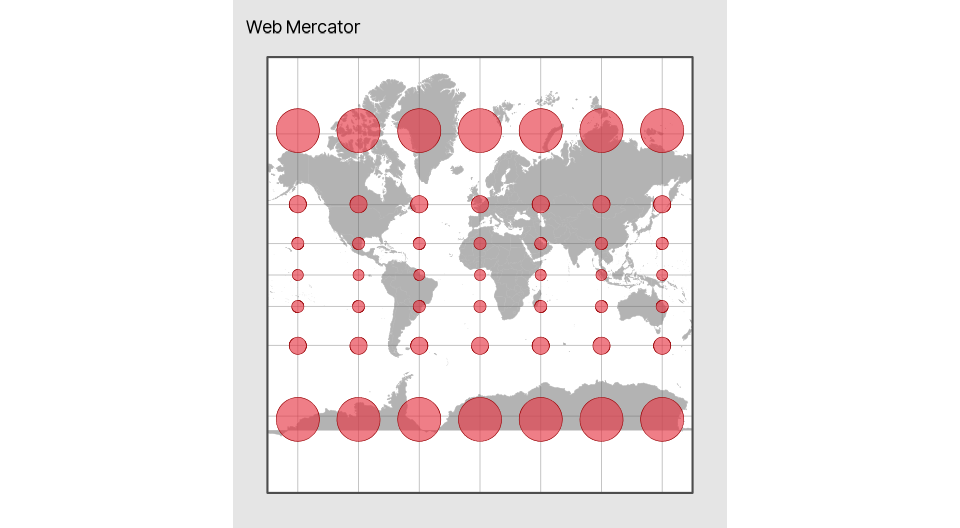
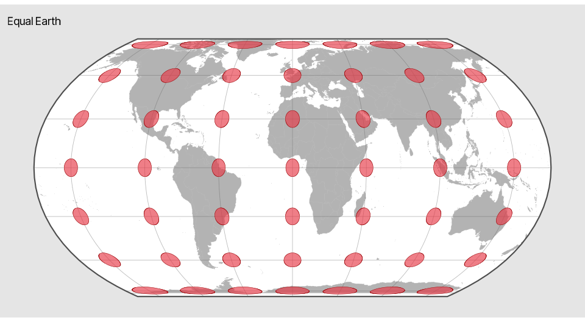
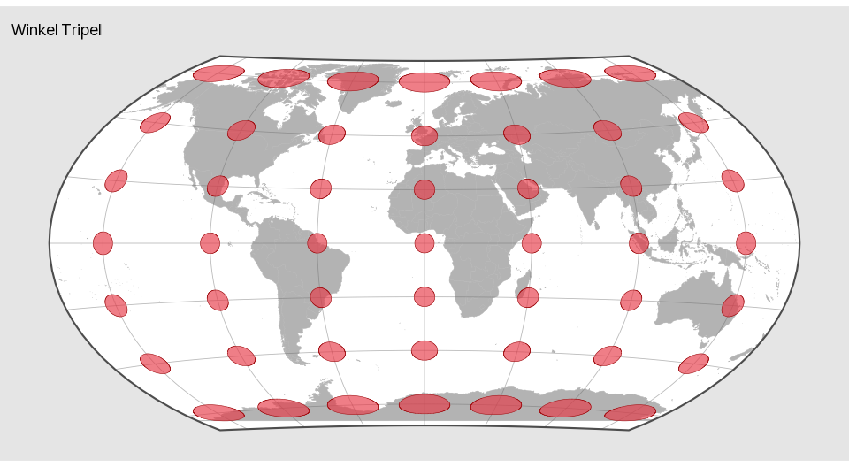
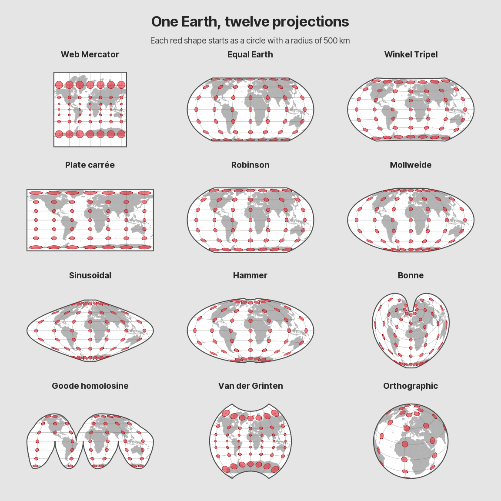

All maps lie. Some lie more than others, and some are deliberately
designed to mislead us. Mark Monmonier wrote a whole book about it.
[*How to Lie with
Maps*](https://press.uchicago.edu/ucp/books/book/chicago/H/bo27400568.html)

Take election maps. Land doesn’t vote. People do. Yet a vast, sparsely
populated region can dominate a map, while a densely populated city
barely gets noticed. [See the same election mapped several
ways](https://www.esri.com/about/newsroom/arcwatch/explore-a-map-of-election-results)

Change the color scale or the class breaks on a choropleth and the same
data can tell a very different story. [See what changing the class
breaks
does](https://www.esri.com/about/newsroom/arcuser/better-breaks-define-your-maps-purpose)

But even the most honest maps lie.

The Earth is (approximately) a sphere, and there’s no way to flatten it
without distorting something. A projection can preserve some properties,
such as area or local angles, at the expense of others.

Fortunately, we have a lie detector. Meet Tissot’s indicatrices.

Imagine placing tiny, identical circles all over the globe. Flatten the
globe and those circles can change size, shape or both. The area of each
ellipse reveals how much the projection inflates or shrinks that spot.
Its shape shows whether the projection stretches more in one direction
than another.

Let’s put some maps to the test.

## Same circles, different maps

We’ll start with the same grid for all twelve projections. At each of
its 49 crossings, we’ll draw a circle with a radius of 500 km. Two maps
show fewer circles where the projection cuts the map or where the globe
turns away from us.

In **R**, we get country boundaries from **giscoR**, build the grid with
**sf** and draw the maps with **ggplot2** and **crstools**.

## Web Mercator

If the circles are still circles, where’s the lie?



Look at the middle row, then look at the top and bottom rows. The
circles stay roughly round, but they take up much more room at high
latitudes. That’s how Greenland gets to look so big.

### A quick technical note

Strictly speaking, Tissot’s indicatrices describe what happens to
infinitesimally small circles. The `geom_tissot()` function in
**crstools** takes a practical approach. It draws geographic buffers
around the grid points and projects them along with the rest of the map.

That gives us a visual approximation. For point-by-point measurements,
the **tissot** package calculates local distortion factors with PROJ.
We’re here to make maps, so the buffers will do nicely.

### How we drew it

The first block sets up the projections, country boundaries and grid.
The second draws the map and handles the cuts in Goode and the horizon
in the orthographic view.

``` r
library(crstools)
library(ggplot2)
library(sf)

map_family <- "inter-tight"
sysfonts::font_add_google("Inter Tight", family = map_family)
showtext::showtext_opts(dpi = knitr::opts_chunk$get("dpi"))
showtext::showtext_auto()

meridians <- seq(-150, 150, 50)
parallels <- seq(-75, 75, 25)
earth_radius <- 6371007.181
map_background <- "grey90"

projections <- c(
  setNames("EPSG:4326", "Plate carr\u00e9e"),
  "Web Mercator" = "EPSG:3857",
  "Robinson" = "+proj=robin",
  "Winkel Tripel" = "+proj=wintri",
  "Mollweide" = "ESRI:54009",
  "Sinusoidal" = "ESRI:54008",
  "Equal Earth" = "+proj=eqearth +datum=WGS84",
  "Hammer" = "+proj=hammer +R=6371007.181",
  "Bonne" = "ESRI:54024",
  "Goode homolosine" = "+proj=igh +R=6371007.181",
  "Van der Grinten" = "ESRI:54029",
  "Orthographic" = "+proj=ortho +lat_0=30 +lon_0=10 +R=6371007.181"
)

frame <- st_linestring(rbind(
  c(-175, 85),
  c(175, 85),
  c(175, -85),
  c(-175, -85),
  c(-175, 85)
)) |>
  st_segmentize(5) |>
  st_cast("POLYGON") |>
  st_sfc(crs = 4326)

world <- giscoR::gisco_get_countries(epsg = 4326, resolution = 10)
graticule <- st_graticule(frame, lon = meridians, lat = parallels)

goode_lat <- c(90:-90, rep(c(-90:0, 0:-90), 3), -90:90, 90:0, 0:90, 90)
goode_lon <- c(
  rep(180, 181),
  rep(c(80.01, 79.99, -19.99, -20.01, -99.99, -100.01), each = 91),
  rep(-180, 181),
  rep(c(-40.01, -39.99), each = 91),
  180
)
goode_frame <- st_sfc(st_polygon(list(cbind(goode_lon, goode_lat))), crs = 4326)

goode_lobes <- rbind(
  c(-180, -40, 0, 90),
  c(-40, 180, 0, 90),
  c(-180, -100, -90, 0),
  c(-100, -20, -90, 0),
  c(-20, 80, -90, 0),
  c(80, 180, -90, 0)
)

goode_lines <- lapply(seq_len(nrow(goode_lobes)), function(index) {
  bounds <- goode_lobes[index, ]
  longitude <- seq(bounds[1] + 0.01, bounds[2] - 0.01, length.out = 361)
  latitude <- seq(bounds[3] + 0.01, bounds[4] - 0.01, length.out = 181)
  lng <- meridians[meridians > bounds[1] & meridians < bounds[2]]
  lat <- parallels[parallels > bounds[3] & parallels < bounds[4]]
  c(
    lapply(lng, function(x) st_linestring(cbind(x, latitude))),
    lapply(lat, function(y) st_linestring(cbind(longitude, y)))
  )
})
goode_grid <- st_sfc(
  c(
    list(st_linestring(cbind(seq(-179.99, 179.99, length.out = 721), 0))),
    do.call(c, goode_lines)
  ),
  crs = 4326
)
```

``` r
indicatrices <- function(lng, lat) {
  geom_tissot(
    data = world,
    radius = units::as_units(500, "km"),
    fill = "#E63946",
    color = "#A4161A",
    alpha = 0.65,
    centres = list(lng = lng, lat = lat)
  )
}

draw_map <- function(title) {
  projection <- projections[[title]]
  grid <- graticule
  circles <- indicatrices(meridians, parallels)
  outline <- st_transform(frame, projection, partial = TRUE)
  land <- st_geometry(world)

  if (title == "Goode homolosine") {
    outline <- st_transform(goode_frame, projection)
    grid <- st_transform(goode_grid, projection)
    circles <- lapply(parallels, function(lat) {
      cuts <- if (lat > 0) -40 else c(-100, -20, 80)
      longitude_gap <- abs((outer(meridians, cuts, "-") + 180) %% 360 - 180)
      distance <- sin(pmin(longitude_gap, 90) * pi / 180) * cos(lat * pi / 180)
      visible <- meridians[apply(distance, 1, min) > sin(500000 / earth_radius)]
      indicatrices(visible, lat)
    })
  }

  if (title == "Orthographic") {
    outline <- st_sfc(st_point(c(0, 0)), crs = projection) |>
      st_buffer(earth_radius, nQuadSegs = 180)

    # Clip land just inside the horizon in a distance-preserving projection.
    distance_crs <- sub("+proj=ortho", "+proj=aeqd", projection, fixed = TRUE)
    hemisphere <- st_sfc(st_point(c(0, 0)), crs = distance_crs) |>
      st_buffer(pi * earth_radius / 2 - 1, nQuadSegs = 180)
    land <- st_transform(land, distance_crs, partial = TRUE) |>
      st_make_valid() |>
      st_intersection(hemisphere)

    # Keep circles whose entire buffer fits on the visible hemisphere.
    radians <- pi / 180
    circles <- lapply(parallels, function(lat) {
      cosine <- sin(lat * radians) * sin(30 * radians) +
        cos(lat * radians) * cos(30 * radians) *
          cos((meridians - 10) * radians)
      visible <- meridians[cosine > sin(500000 / earth_radius)]
      if (length(visible)) indicatrices(visible, lat)
    })
  }

  limits <- st_bbox(outline)
  land <- st_transform(land, projection, partial = TRUE)
  if (st_is_longlat(land)) {
    # Clip the longitude-latitude panel in its display coordinates.
    land <- st_set_crs(land, NA) |>
      st_make_valid() |>
      st_intersection(st_set_crs(outline, NA)) |>
      st_set_crs(projection)
  } else {
    land <- st_intersection(st_make_valid(land), st_make_valid(outline))
  }

  ggplot() +
    geom_sf(data = outline, fill = "white", color = NA) +
    geom_sf(data = land, fill = "grey70", color = "grey70", linewidth = 0.15) +
    geom_sf(
      data = grid,
      color = "grey40",
      alpha = 0.45,
      linewidth = 0.3
    ) +
    geom_sf(data = outline, fill = NA, color = "grey30", linewidth = 0.75) +
    circles +
    coord_sf(
      crs = projection,
      xlim = limits[c("xmin", "xmax")],
      ylim = limits[c("ymin", "ymax")],
      datum = NA
    ) +
    labs(title = title) +
    theme_void(base_family = map_family) +
    theme(
      plot.margin = margin(10, 10, 10, 10),
      plot.background = element_rect(fill = map_background, color = NA),
      panel.background = element_rect(fill = map_background, color = NA)
    )
}
```

## Equal Earth

Let’s see what happens when we make area the one thing the map has to
get right.

``` r
draw_map("Equal Earth")
```



The shapes give the game away. The circles flatten toward the top and
bottom, but their areas stay roughly the same. Greenland can keep its
place on the map without borrowing space from the tropics.

## Winkel Tripel

What if we spread the distortion around? Winkel Tripel is a compromise
projection. Follow the 50° N row from the central meridian toward either
edge and watch the ellipses stretch and tilt. Then compare them with the
ones along the equator to see how their area changes too.

``` r
draw_map("Winkel Tripel")
```



## What if we cut the map?

The interrupted Goode homolosine projection preserves area. It also
splits the world into lobes, which helps keep shapes closer to what we’d
see on a globe. Imagine dropping our red circles onto the pieces of an
orange peel. A circle that straddles a cut would show up in two pieces,
so we leave it out of the gallery. [Let’s peel the
world](https://dieghernan.github.io/202610_orange-peel/)

## Twelve ways to flatten the world

Find the red circle over Greenland and follow it from map to map. The
orthographic view, centered over North Africa, looks like a globe from
space. It shows only the circles that fit entirely on the visible side.
Each map is scaled to fit its panel, so compare the shapes and relative
sizes of the red circles within each map.

``` r
featured <- c("Web Mercator", "Equal Earth", "Winkel Tripel")
gallery_order <- c(featured, setdiff(names(projections), featured))
maps <- lapply(gallery_order, function(title) {
  draw_map(title) + theme(plot.title = element_blank())
})

grid::grid.newpage()
grid::grid.rect(gp = grid::gpar(fill = map_background, col = NA))
grid::pushViewport(grid::viewport(
  width = 0.96,
  height = 0.96,
  layout = grid::grid.layout(
    6, 3,
    heights = grid::unit(c(2, 1.5, 10, 10, 10, 10), "null")
  )
))
grid::grid.text(
  "One Earth, twelve projections",
  gp = grid::gpar(
    fontfamily = map_family, fontsize = 25, fontface = "bold", col = "grey15"
  ),
  vp = grid::viewport(layout.pos.row = 1, layout.pos.col = 1:3)
)
grid::grid.text(
  "Each red shape starts as a circle with a radius of 500 km",
  gp = grid::gpar(fontfamily = map_family, fontsize = 14, col = "grey25"),
  vp = grid::viewport(layout.pos.row = 2, layout.pos.col = 1:3)
)

for (index in seq_along(maps)) {
  grid::pushViewport(grid::viewport(
    layout.pos.row = (index - 1) %/% 3 + 3,
    layout.pos.col = (index - 1) %% 3 + 1,
    layout = grid::grid.layout(2, 1, heights = grid::unit(c(1, 9), "null"))
  ))
  grid::grid.text(
    gallery_order[[index]],
    gp = grid::gpar(
      fontfamily = map_family, fontsize = 14, fontface = "bold", col = "grey15"
    ),
    vp = grid::viewport(layout.pos.row = 1)
  )
  grid::pushViewport(grid::viewport(layout.pos.row = 2))
  print(maps[[index]], vp = grid::viewport(width = 0.94, height = 0.94))
  grid::popViewport(2)
}
grid::popViewport()
```



So, which map should you trust? Depends on what you’re asking it to
show.
