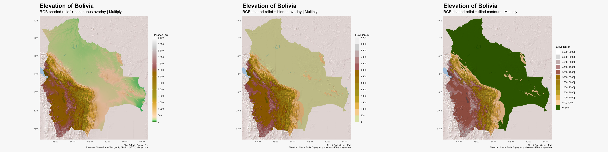

# Bolivia: elevation over RGB relief

Compare three representations of SRTM elevation blended with an Esri RGB
shaded-relief background using `ggblend::blend("multiply")`:

- Continuous elevation colors with a color bar.
- Binned elevation colors with a stepped legend.
- Filled elevation contours with a discrete legend.

The experiment uses the `etopo1_hypso` palette, with limits of 0–6,500 m and
breaks every 500 m. The continuous and binned scales share explicit palette
stops. The contour version samples a discrete palette, so its colors need not
match those of the other two versions exactly.

## Run

From the repository root:

```sh
Rscript _experiments/bolivia-overlay/bolivia-overlay.R
```

R dependencies: `terra`, `tidyterra`, `ggplot2`, `geodata`, `maptiles`, `sf`,
`scales`, `ggblend`, `ragg` and `magick`.

## Data and rendering

Elevation comes from `geodata::elevation_30s()`. The background is
`Esri.WorldShadedRelief` at zoom 7, downloaded with `maptiles`. Data are cached
under `~/R/mapslib/misc`; tiles and reusable mosaics are stored in its
`maptiles` and `maptiles/mosaics` subdirectories. The first run requires network
access. Edit `data_dir` in the script to use another cache location.

The tile download covers the elevation raster's bounding box. There is no
additional vector mask: the background remains visible outside the elevation
coverage. Elevation is projected onto the RGB grid, and `compareGeom()` checks
that the grids match.

The RGB layer supplies its own colors, leaving one `fill` scale for elevation.
The legend shows the unblended elevation palette; the background also affects
the map's final colors. All raster cells are plotted with `maxcell = Inf`, and
`ragg` renders the compositing groups.

## Outputs

Files are saved beside the script:

- `bolivia-overlay-continuous.png`
- `bolivia-overlay-binned.png`
- `bolivia-overlay-contours.png`
- `bolivia-overlay-comparison.png`: the three maps side by side.
- `session-info.txt`: the R environment used for rendering.

Individual maps are 12 × 9 inches at 220 dpi. The comparison scales each map
to 1,200 pixels wide before joining them.



Based on the [tidyterra overlay example](https://dieghernan.github.io/tidyterra/dev/articles/faqs.html#overlay).
