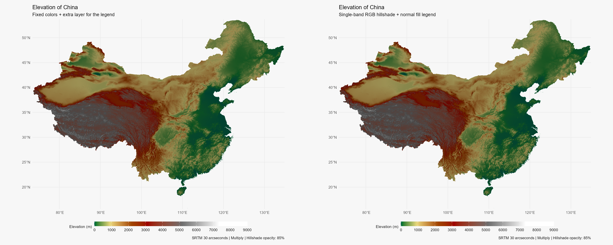

# China: a single-band RGB hillshade

Test the alternative proposed in the [hillshade discussion](https://github.com/dieghernan/dieghernan.github.io/discussions/36#discussioncomment-8696064):
stretch a hillshade to 0–255 and display the same band as all three RGB
channels.
The background is combined with elevation using `ggblend::blend("multiply")`.

The RGB version needs only the standard elevation `fill` scale. It does not
extract fixed color vectors or add a hidden thematic layer to recover the
legend. The reference uses fixed colors and an additional layer that trains the
elevation scale,
as in the other hillshade blending experiments.

## Run

From the repository root:

```sh
Rscript _experiments/china-rgb-hillshade/china-rgb-hillshade.R
```

R dependencies: **terra**, **tidyterra**, **ggplot2**, **geodata**, **scales**,
**ggblend**,
**ragg** and **magick**. No GDAL CLI installation is needed.

## Download and cache locations

The script passes `~/R/mapslib/misc` explicitly to
`geodata::elevation_30s("CHN")`. The ZIP is downloaded and unpacked in its
`elevation` subdirectory. In this run, geodata retained the extracted DEM and
removed the ZIP after extraction. On this Windows setup, `~` resolves to
`C:/Users/diego/Documents`, not `C:/Users/diego`.

Full-resolution processed rasters are written to
`~/R/mapslib/misc/derived/china-rgb-hillshade/`:

- `elevation.tif`: elevation clamped to zero.
- `hillshade.tif`: hillshade calculated from the full-resolution DEM.
- `hillshade-stretched.tif`: hillshade stretched to 0–255.

Temporary slope and aspect files are created in that same external directory
and removed after calculating hillshade. The script checks that the derived
cache is outside the repository. No downloaded DEM, ZIP or derived GeoTIFF is
saved in this experiment folder.

The first run needs network access for the roughly 30 MB China download.
Subsequent runs reuse the downloaded data and recompute the derived rasters.
Edit `data_dir` in the script to use another external cache location.

## A controlled comparison

The source DEM has roughly 33.7 million cells. Hillshade is calculated before
sampling, with a light altitude of 30 degrees and an azimuth of 270 degrees.
Both maps use the `dem_poster` elevation palette and hillshade opacity of 85%.

The RGB method receives the full file-backed rasters and sets `maxcell` to two
million for plotting. The fixed-color reference samples first, then extracts
its color vectors. Regular sampling can produce slightly more than the
requested number of cells; the script checks that the displayed grids match.

Both methods use the same linear RGB grays, with `minq = 0` and `maxq = 1`,
and disable raster interpolation. This isolates the representation change
from differences in contrast or grayscale palette. It does not reproduce the
HCL grayscale ramp used by some of the older examples.

The script checks the thematic scale and plotting cell counts. This is a visual
and functional comparison, not a peak-memory benchmark: ggplot2 still needs to
build data for the sampled plotting grid.

## Outputs

- `china-reference.png`: fixed colors with an extra layer for the legend.
- `china-rgb.png`: single-band RGB hillshade with a standard elevation legend.
- `china-comparison.png`: both maps side by side.
- `validation.txt`: resolved cache paths, grid dimensions and scale checks.
- `session-info.txt`: the R environment used for rendering.

Individual maps are 10 × 8 inches at 180 dpi.


