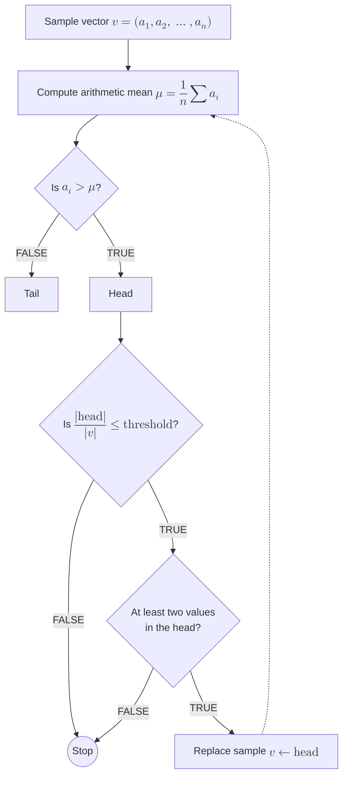

Has alerts? TRUE
Has Spotify? FALSE
Has iframe? FALSE
Has details_summary? FALSE
Has math? TRUE
Has includes? FALSE

<blockquote class="blockquote">

<p class="small font-italic">

There are far more ordinary people (say, 80 percent) than extraordinary people (say, 20 percent), and this is often characterized by the 80/20 principle, based on the observation made by the Italian economist Vilfredo Pareto in 1906 that 80% of land in Italy was owned by 20% of the population. A histogram of the data values for these phenomena would reveal a right-skewed or heavy-tailed distribution. How to map the data with the heavy-tailed distribution?

</p>

<footer class="blockquote-footer text-right">

Jiang (2013)

</footer>

</blockquote>

## Abstract

This article explains how `classIntervals()` in **classInt** implements head/tail breaks (Jiang, 2013). A worked example follows the algorithm one iteration at a time. The case study compares head/tail breaks, Fisher–Jenks and quantiles using the African conflict data in `spData::afcon`.

<div class="callout-note" role="note" aria-label="Note" markdown="1">
**Update (23 November 2026)**

This revision updates the **R** code and figures, clarifies the stopping rule and compares head/tail breaks with Fisher–Jenks and quantiles. The original publication date has been preserved.

See also the [**classInt** package vignette](https://r-spatial.github.io/classInt/articles/headtailsR.html).

</div>

## Introduction

**Head/tail breaks** is a classification scheme introduced by Jiang (2013) for revealing hierarchies in data with many small values and a few large ones. The related **ht-index** summarizes how deeply this pattern recurs across scales (Jiang & Yin, 2014).

In the examples below, the distributions are strongly right-skewed. A few large values form the head and many smaller values form the tail.

Power-law and lognormal distributions are examples of heavy-tailed distributions. The head/tail breaks literature also uses exponential distributions to illustrate the imbalance. Rare, large outcomes matter in applications such as portfolio credit risk (Vasicek, 2002) and in broader discussions of extreme events (Taleb, 2008).

``` r
library(classInt)
library(tidyverse)
library(scales)

# Define a common theme for the plots.
background <- "#FEFDFD"

map_title <- "inter-tight"
map_regular <- "inter"

sysfonts::font_add_google("Inter Tight", family = map_title)
sysfonts::font_add_google("Inter", family = map_regular)
showtext::showtext_opts(dpi = knitr::opts_chunk$get("dpi"))
showtext::showtext_auto()

theme_set(
  theme_bw(paper = background, base_family = map_regular) +
    theme(
      rect = element_rect(fill = background),
      plot.title = element_text(family = map_title, face = "bold"),
      legend.title = element_text(family = map_title, face = "bold"),
      strip.text = element_text(family = map_title, face = "bold"),
      plot.margin = margin(10, 10, 10, 10)
    )
)

# 1. Characterization of heavy-tail distributions----
set.seed(1234)
# Pareto distribution a=1 b=1.161 n=1000
sample_par <- (1 - runif(1000))^(-1 / (log(5) / log(4)))

sample_par_df <- tibble(x = sample_par) |>
  arrange(desc(x)) |>
  mutate(
    prop = row_number() / n(),
    cumulative = cumsum(x) / sum(x)
  )

ggplot(sample_par_df, aes(prop, cumulative)) +
  geom_line() +
  geom_vline(xintercept = 0.2, linetype = "dashed") +
  geom_hline(yintercept = 0.8, linetype = "dashed") +
  scale_x_continuous(labels = label_percent()) +
  scale_y_continuous(labels = label_percent()) +
  labs(
    title = "How much of the total does the top 20% account for?",
    subtitle = "Cumulative share in a simulated Pareto sample",
    x = "Top proportion of observations",
    y = "Cumulative share of total"
  )
```


``` r

# Histogram
ggplot(sample_par_df, aes(x = x)) +
  geom_histogram(
    aes(y = after_stat(density)),
    bins = 100,
    fill = "grey50",
    color = NA
  ) +
  scale_x_continuous(labels = label_comma()) +
  scale_y_continuous(labels = label_comma()) +
  labs(
    title = "A simulated Pareto sample",
    subtitle = "Most observations are small, with a few large values",
    x = "Value",
    y = "Density"
  )
```


## Breaking method

The method itself consists of a four-step process performed recursively until a stopping condition is satisfied. Given a vector of values
``` math
v = (a_1, a_2,
..., a_n) 
```
, the process can be described as follows:

1.  Compute the arithmetic mean,
    ``` math
    \mu = \frac{1}{n}\sum_{i=1}^{n} a_i
    ```
    .
2.  Break
    ``` math
    v
    ```
    into the
    ``` math
    tail
    ```
    and the
    ``` math
    head
    ```
    :
    ``` math
    tail = \{ a_x \in v | a_x \le \mu \} 
    ```
    ``` math
    head = \{ a_x \in v | a_x \gt \mu \} 
    ```
    .
3.  Check whether the proportion of observations in the head is at most the chosen threshold:
    ``` math
    \frac{|head|}{|v|} \le threshold  
    ```
4.  If step 3 is `TRUE` and the head contains at least two observations, replace
    ``` math
    v
    ```
    with
    ``` math
    head
    ```
    and repeat. Otherwise, stop.

Only values strictly above the mean enter the next iteration. Values equal to the mean stay in the tail.

A threshold of 40% is a practical stopping rule (Jiang et al., 2013). It does not provide a statistical test for a heavy-tailed distribution.

At each iteration, the arithmetic mean separates the head from the tail. Repeat with the head only if it contains at least two observations and its share of the sample is at or below the threshold.







Each iteration produces a new break at the arithmetic mean of the current sample. Once the stopping condition is met, the final set of breaks is obtained by collecting the successive means computed throughout the process:

``` math
 breaks = (\mu_1, \mu_2, \mu_3, ..., \mu_k ) 
```

## Step-by-step example

Jiang (2019) summarizes the original procedure in this pseudocode[^1]:

    Recursive function Head/tail Breaks:
     Rank the input data from the largest to the smallest
     Break the data into the head and the tail around the mean;
     // the head for those above the mean
     // the tail for those below the mean
     While (head <= 40%):
     Head/tail Breaks (head);
    End Function

The **R** example continues only when `prop < thr`. The pseudocode allows equality, so the two stop at different points if the head contains exactly 40% of the observations. That case does not occur in this sample.

``` r
var <- sample_par
thr <- 0.4
brks <- range(var, na.rm = TRUE)

iterations <- list()
summary_rows <- list()

for (i in seq_len(10)) {
  mu <- mean(var)
  head_values <- var[var > mu]
  prop <- length(head_values) / length(var)

  brks <- sort(c(brks, mu))

  iterations[[i]] <- tibble(
    iter = i,
    value = var,
    mu = mu,
    prop = prop
  )

  summary_rows[[i]] <- tibble(
    iter = i,
    mu = mu,
    prop = prop,
    n_var = length(var),
    n_head = length(head_values)
  )

  if (!(prop < thr && length(head_values) > 1)) {
    break
  }

  var <- head_values
}

iter_df <- bind_rows(iterations) |>
  mutate(iter = factor(iter, levels = unique(iter)))

sum_table <- bind_rows(summary_rows)

# Prepare plot
labels_df <- sum_table |>
  mutate(
    iter = factor(iter, levels = levels(iter_df$iter)),
    label = paste0(
      "Share of observations\nin the head:\n",
      label_percent(accuracy = 0.1)(prop)
    )
  )

iter_df |>
  group_by(iter) |>
  ggplot(aes(x = value)) +
  geom_histogram(
    bins = 50,
    fill = "grey50",
    color = NA
  ) +
  # Areas
  geom_rect(
    aes(xmin = mu, xmax = Inf, ymin = -Inf, ymax = Inf),
    fill = "red",
    alpha = 0.1,
    data = ~ slice_head(.x, n = 1)
  ) +
  geom_vline(
    data = labels_df,
    aes(xintercept = mu),
    linetype = "dashed",
    color = "red3"
  ) +
  geom_text(
    data = labels_df,
    aes(x = mu, y = Inf, label = label),
    inherit.aes = FALSE,
    position = position_nudge(x = 20),
    hjust = 0,
    vjust = 1.5,
    size = 3
  ) +
  facet_wrap(
    vars(iter),
    scales = "free_y",
    labeller = labeller(iter = ~ paste("Iteration", .x))
  ) +
  scale_x_continuous(labels = label_comma()) +
  scale_y_continuous(
    labels = label_comma(accuracy = 1),
    breaks = breaks_extended(n = 3)
  ) +
  labs(
    title = "Head/tail breaks across four iterations",
    subtitle = "Shading marks the head above the mean",
    x = "Value",
    y = "Count"
  )
```


The head accounts for 50% of the remaining observations in the fourth iteration. That exceeds the 40% threshold and stops the loop.

| iter |       mu | prop   | n_var | n_head |
|-----:|---------:|:-------|------:|-------:|
|    1 |   5.6760 | 14.5%  |  1000 |    145 |
|    2 |  27.2404 | 21.38% |   145 |     31 |
|    3 |  85.1897 | 19.35% |    31 |      6 |
|    4 | 264.7597 | 50%    |     6 |      3 |

The break vector includes the original minimum and maximum, plus the means computed during the iterations. Here the original data are `sample_par`, since `var` is replaced by the head inside the loop.

## Implementation in the **classInt** package

The implementation in `classIntervals()` reproduces these results:

``` r
# Compare with classInt
ht_sample_par <- classIntervals(
  sample_par,
  style = "headtails"
)

all.equal(brks, ht_sample_par$brks)
#> [1] TRUE
```

The data determine the number of breaks (Jiang, 2013). The `thr` argument controls how large the head can be before recursion stops. In the next figure, higher thresholds let the algorithm continue for more iterations.

``` r
thresholds <- c(0, 0.2, 0.4, 1)

breaks_df <- lapply(thresholds, function(thr) {
  ci <- classIntervals(
    sample_par,
    style = "headtails",
    thr = thr
  )

  tibble(
    threshold = paste0("thr = ", thr),
    value = sample_par,
    class = findInterval(
      sample_par,
      ci$brks,
      all.inside = TRUE
    ),
    n_classes = length(ci$brks) - 1
  ) |>
    # Prepare rect
    group_by(threshold, n_classes, class) |>
    summarise(xmin = min(value), xmax = max(value), .groups = "drop_last") |>
    mutate(
      xmin = ifelse(row_number() == 1, -Inf, lag(xmax)),
      xmax = ifelse(row_number() == n(), Inf, xmax)
    ) |>
    ungroup()
}) |>
  bind_rows() |>
  mutate(
    threshold = factor(
      threshold,
      levels = paste0("thr = ", thresholds)
    )
  )

# Number of classes
breaks_df |>
  distinct(threshold, n_classes) |>
  knitr::kable(row.names = FALSE)
```

| threshold | n_classes |
|:----------|----------:|
| thr = 0   |         2 |
| thr = 0.2 |         3 |
| thr = 0.4 |         5 |
| thr = 1   |         6 |

``` r

# Distribution of observations across classes
ggplot(breaks_df, aes(fill = factor(class))) +
  stat_ecdf(
    data = tibble(x = sample_par),
    aes(x = x),
    inherit.aes = FALSE,
    linetype = "dashed"
  ) +
  stat_ecdf(
    data = tibble(x = sample_par),
    aes(x = x),
    inherit.aes = FALSE,
    geom = "point",
    size = 1.5,
    pad = FALSE
  ) +
  # Areas
  geom_rect(aes(xmin = xmin, xmax = xmax, ymin = -Inf, ymax = Inf)) +
  facet_wrap(~threshold, scales = "free_x") +
  scale_x_continuous(labels = label_comma()) +
  scale_y_continuous(labels = label_percent()) +
  scale_fill_viridis_d(option = "cividis", alpha = 0.5) +
  labs(
    title = "How the stopping threshold affects the breaks",
    subtitle = "Four thresholds applied to the same Pareto sample",
    x = "Value",
    y = "Cumulative proportion",
    fill = "Class"
  )
```


Even at `thr = 0`, the algorithm makes the initial split at the mean. Together with the minimum and maximum, this gives two classes.

## Case study

Jiang (2013) proposed head/tail breaks as a way to reveal the hierarchy in heavy-tailed data. Here we compare `headtails`, `fisher` (Fisher–Jenks) and `quantile` using `afcon` from **spData**. Each method uses the same number of classes as head/tail breaks.

``` r
library(spData)
data(afcon, package = "spData")
```

The variable `totcon` is an index of total conflict from 1966 to 1978. The table shows the 10 highest values.

``` r
# Top10
knitr::kable(head(
  afcon[order(afcon$totcon, decreasing = TRUE), c("name", "totcon")],
  10
))
```

|     | name         | totcon |
|:----|:-------------|-------:|
| EG  | EGYPT        |   5246 |
| SU  | SUDAN        |   4751 |
| UG  | UGANDA       |   3134 |
| CG  | ZAIRE        |   3087 |
| TZ  | TANZANIA     |   2881 |
| LY  | LIBYA        |   2355 |
| KE  | KENYA        |   2273 |
| SO  | SOMALIA      |   2122 |
| ET  | ETHIOPIA     |   1878 |
| SF  | SOUTH AFRICA |   1875 |

``` r

ggplot(afcon, aes(x = totcon)) +
  geom_histogram(bins = 30) +
  scale_x_continuous(labels = label_comma(accuracy = 1)) +
  scale_y_continuous(labels = label_comma()) +
  labs(
    title = "Distribution of the conflict index, 1966–1978",
    subtitle = "African countries grouped by index value",
    x = "Conflict index",
    y = "Number of countries",
    caption = "Data source: Anselin & O'Loughlin (1992)"
  )
```


``` r

ggplot(afcon, aes(x = totcon)) +
  geom_density() +
  scale_x_continuous(labels = label_comma(accuracy = 1)) +
  scale_y_continuous(labels = label_comma()) +
  labs(
    title = "The conflict index is right-skewed",
    subtitle = "Density estimate for African countries, 1966–1978",
    x = "Conflict index",
    y = "Density",
    caption = "Data source: Anselin & O'Loughlin (1992)"
  )
```


Egypt and Sudan have the two highest index values. The histogram shows the same imbalance seen in the simulated sample: many lower values and a few much larger ones.

Quantile breaks use ranks to put roughly the same number of observations in each class. The code below applies all three methods to the same data.

``` r
afcon$headtails <- classify_intervals(afcon$totcon, style = "headtails")
afcon$headtails_br <- as.numeric(afcon$headtails)

# Record the number of classes to set the same

nclass <- length(levels(afcon$headtails))

# Same number of classes for "fisher"
afcon$fisher <- classify_intervals(afcon$totcon, style = "fisher", n = nclass)
afcon$fisher_br <- as.numeric(afcon$fisher)

afcon$quantile <- classify_intervals(
  afcon$totcon,
  style = "quantile",
  n = nclass
)
afcon$quantile_br <- as.numeric(afcon$quantile)

levels(afcon$headtails)
#> [1] "[147,1350.619)"    "[1350.619,2488.6)" "[2488.6,3819.8)"
#> [4] "[3819.8,4998.5)"   "[4998.5,5246]"
levels(afcon$fisher)
#> [1] "[147,693.5)"    "[693.5,1474.5)" "[1474.5,2618)"  "[2618,3942.5)"
#> [5] "[3942.5,5246]"
levels(afcon$quantile)
#> [1] "[147,604)"       "[604,833.6)"     "[833.6,1137.2)"  "[1137.2,1877.4)"
#> [5] "[1877.4,5246]"

ht_breaks <- classIntervals(afcon$totcon, style = "headtails")$brks[seq_len(
  nclass
)]

fisher_breaks <- classIntervals(
  afcon$totcon,
  style = "fisher",
  n = nclass
)$brks[seq_len(nclass)]

q_breaks <- classIntervals(
  afcon$totcon,
  style = "quantile",
  n = nclass
)$brks[seq_len(nclass)]

tibble(
  id_breaks = "Head/tail breaks",
  b = ht_breaks,
  group = as.factor(seq_along(ht_breaks))
) |>
  bind_rows(
    tibble(
      id_breaks = "Fisher–Jenks",
      b = fisher_breaks,
      group = as.factor(seq_along(fisher_breaks))
    )
  ) |>
  bind_rows(
    tibble(
      id_breaks = "Quantiles",
      b = q_breaks,
      group = as.factor(seq_along(q_breaks))
    )
  ) |>
  mutate(id_breaks = fct_inorder(id_breaks)) |>
  # Prepare rects
  group_by(id_breaks) |>
  mutate(
    xmin = if_else(row_number() == 1, -Inf, b),
    xmax = if_else(row_number() == n(), Inf, lead(b))
  ) |>
  ggplot() +
  stat_ecdf(
    data = afcon,
    aes(x = totcon),
    geom = "point",
    size = 1,
    pad = FALSE
  ) +
  # Areas
  geom_rect(aes(
    xmin = xmin, xmax = xmax, ymin = -Inf, ymax = Inf,
    fill = group
  )) +
  facet_wrap(vars(id_breaks), ncol = 1) +
  scale_x_continuous(labels = label_comma(accuracy = 1)) +
  scale_y_continuous(labels = label_percent()) +
  scale_fill_viridis_d(option = "cividis", alpha = 0.5) +
  guides(color = guide_legend(), fill = guide_legend(override.aes = list(alpha = 1))) +
  labs(
    title = "Where the three methods place their class breaks",
    subtitle = "Head/tail breaks, Fisher–Jenks and quantiles",
    x = "Conflict index",
    y = "Cumulative proportion",
    fill = "Class"
  )
```


The top three classes of `headtails` contain five observations, whereas those of `fisher` contain 13. In this example, `headtails` gives more detail at the upper end of the distribution.

The next plot compares smoothed distributions across methods. For this comparison, the original `totcon` values are rescaled and rounded to the same five levels as the class indices.

``` r
# Rescale values for visualization
afcon$data <- rescale(afcon$totcon,
  to = range(afcon$headtails_br) + c(-0.4, 0.4)
) |> round()

afcon |>
  as_tibble() |>
  pivot_longer(
    cols = c(data, headtails_br, fisher_br, quantile_br),
    names_to = "class_name",
    values_to = "class"
  ) |>
  mutate(
    class_name = case_when(
      class_name %in% c("data", "original") ~ "Original values (rescaled)",
      class_name == "headtails_br" ~ "Head/tail breaks",
      class_name == "fisher_br" ~ "Fisher–Jenks",
      TRUE ~ "Quantiles"
    )
  ) |>
  mutate(class_name = fct_inorder(class_name)) |>
  ggplot() +
  geom_density(
    aes(x = class, color = class_name),
    key_glyph = draw_key_path,
    trim = TRUE,
    adjust = .75,
    linewidth = 1
  ) +
  scale_x_continuous(
    labels = label_comma(accuracy = 1),
    breaks = seq(1, nclass, 1)
  ) +
  scale_y_continuous(labels = label_comma()) +
  scale_color_viridis_d(option = "cividis") +
  labs(
    title = "How the methods distribute observations across classes",
    subtitle = "Smoothed distributions of class indices",
    x = "Rescaled value / Class index",
    y = "Estimated density",
    color = "Classification method"
  )
```


In this example, the class assignments from `headtails` retain more of the original imbalance. By contrast, `quantile` aims for similar numbers of observations per class, regardless of the gaps between values.

The maps show where these differences appear. Circle size and color encode the rescaled conflict index in the unclassified panel and the assigned class in each of the other three panels.

``` r
library(giscoR)
library(sf)

africa <- gisco_get_countries(
  resolution = 60,
  region = "Africa",
  epsg = 3857
) |>
  st_transform("ESRI:102024")

africa_focus <- st_linestring(rbind(
  c(-20, 40),
  c(60, 40),
  c(60, -40),
  c(-20, -40),
  c(-20, 40)
)) |>
  st_segmentize(5) |>
  st_cast("POLYGON") |>
  st_sfc(crs = 4326) |>
  st_transform(st_crs(africa)) |>
  st_bbox()

afcon_sf <- st_as_sf(afcon, crs = 4326, coords = c("x", "y")) |>
  st_transform(st_crs(africa)) |>
  arrange(desc(totcon))

afcon_sf |>
  mutate(original = rescale(totcon, to = c(1, 5))) |>
  pivot_longer(
    cols = c(original, headtails_br, fisher_br, quantile_br),
    names_to = "class_name",
    values_to = "class"
  ) |>
  mutate(
    class_name = case_when(
      class_name %in% c("data", "original") ~ "Original values (rescaled)",
      class_name == "headtails_br" ~ "Head/tail breaks",
      class_name == "fisher_br" ~ "Fisher–Jenks",
      TRUE ~ "Quantiles"
    )
  ) |>
  mutate(class_name = fct_inorder(class_name)) |>
  arrange(desc(totcon)) |>
  ggplot() +
  geom_sf(data = africa, color = "grey80", fill = "grey80") +
  geom_sf(aes(size = class, color = class)) +
  coord_sf(
    xlim = c(africa_focus[c("xmin", "xmax")]),
    ylim = c(africa_focus[c("ymin", "ymax")]),
    expand = FALSE
  ) +
  facet_wrap(~class_name) +
  guides(
    color = guide_legend(reverse = TRUE),
    size = guide_legend(reverse = TRUE)
  ) +
  scale_color_viridis_c(
    option = "cividis",
    alpha = 0.75,
    breaks = seq(1, 5, 1)
  ) +
  theme(
    panel.grid = element_blank(),
    axis.line = element_blank(),
    axis.text = element_blank(),
    axis.ticks = element_blank()
  ) +
  labs(
    title = "How classification changes the map",
    subtitle = "Symbol sizes represent original values or assigned classes",
    color = "Class index",
    size = "Class index"
  )
```


Head/tail breaks separates the highest index values into smaller groups. Fisher–Jenks spreads the middle and lower values across more classes, which makes distinctions among countries in West Africa easier to see in this example. Quantiles keep class sizes similar. The choice depends on which part of the distribution the map needs to emphasize.

## References

- Anselin, L., & O’Loughlin, J. (1992). Geography of international conflict and cooperation: Spatial dependence and regional context in Africa. In M. D. Ward (Ed.), *The new geopolitics* (pp. 39–75). Gordon and Breach Science Publishers.
- Jiang, B. (2013). Head/tail breaks: A new classification scheme for data with a heavy-tailed distribution. *The Professional Geographer, 65*(3), 482–494. [DOI](https://doi.org/10.1080/00330124.2012.700499)
- Jiang, B. (2019). A recursive definition of goodness of space for bridging the concepts of space and place for sustainability. *Sustainability, 11*(15), Article 4091. <https://doi.org/10.3390/su11154091>
- Jiang, B., Liu, X., & Jia, T. (2013). Scaling of geographic space as a universal rule for map generalization. *Annals of the Association of American Geographers, 103*(4), 844–855. [DOI](https://doi.org/10.1080/00045608.2013.765773)
- Jiang, B., & Yin, J. (2014). Ht-index for quantifying the fractal or scaling structure of geographic features. *Annals of the Association of American Geographers, 104*(3), 530–540. [DOI](https://doi.org/10.1080/00045608.2013.834239)
- Taleb, N. N. (2008). *The black swan: The impact of the highly improbable*. Penguin.
- Vasicek, O. (2002, December). Loan portfolio value. *Risk, 15*(12), 160–162. [Article](https://www.risk.net/risk-management/credit-risk/1530287/loan-portfolio-value)

[^1]: The method implemented in **classInt** corresponds to head/tail breaks 1.0 in Jiang’s (2019) terminology.
