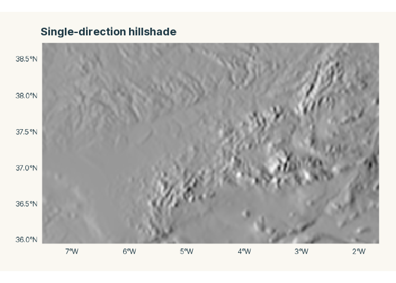
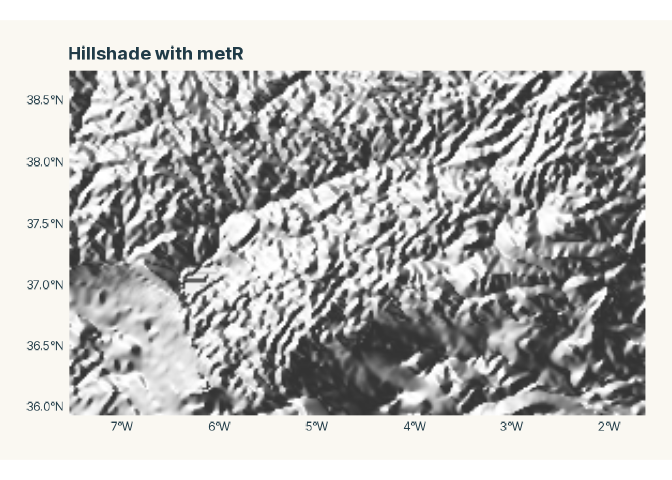
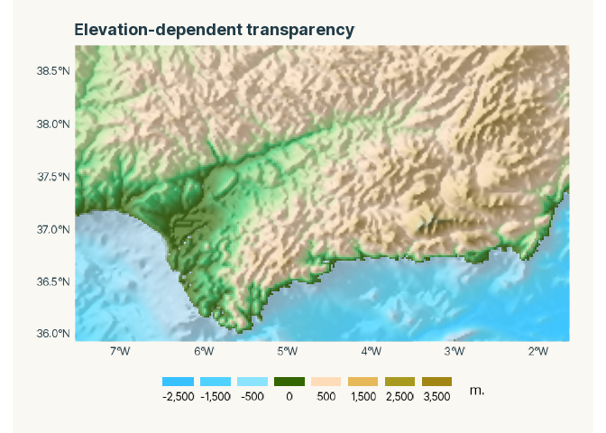
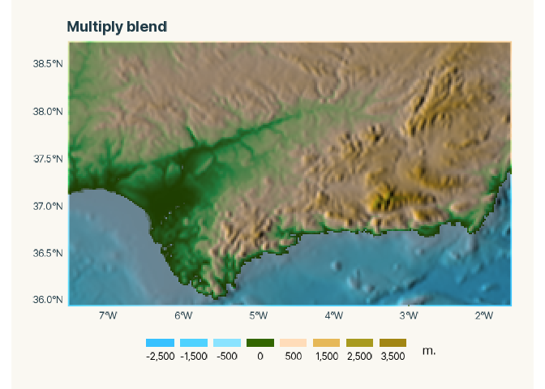
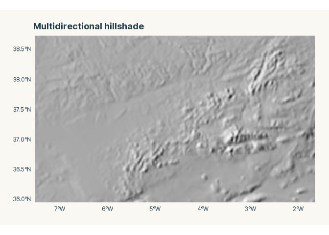
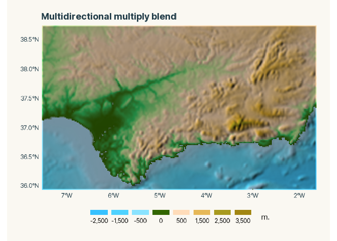
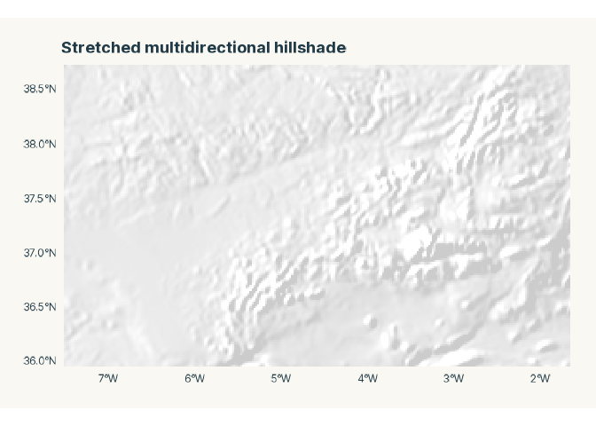
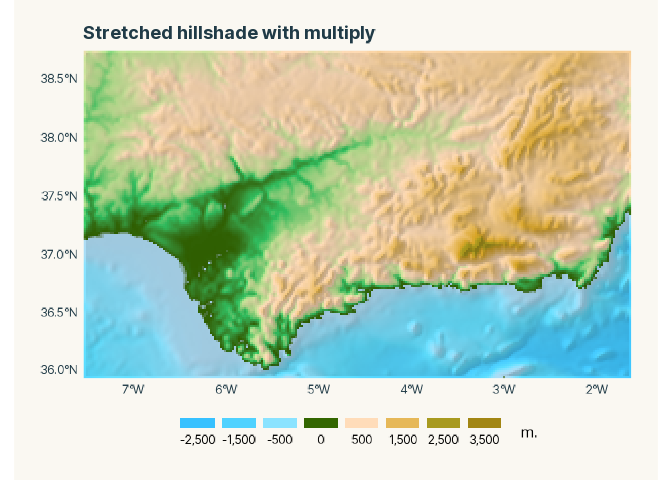
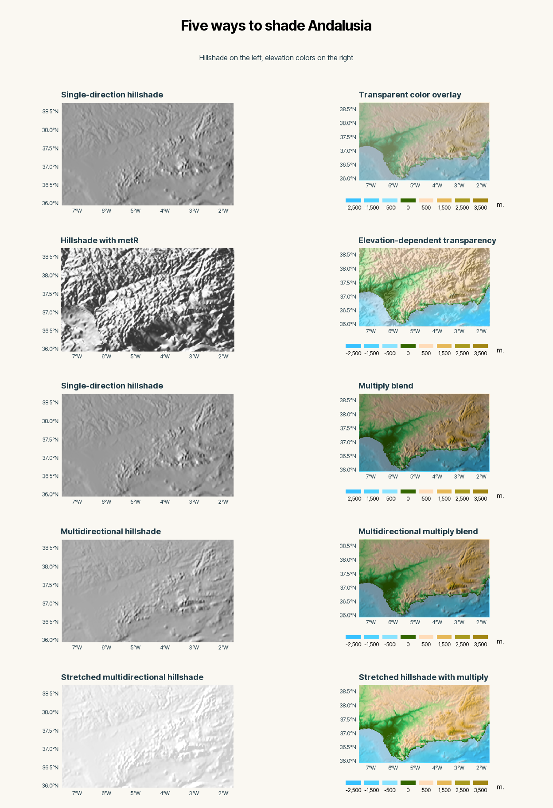

Lately, I’ve been revisiting my earlier posts on hillshading and the
**tidyterra** FAQ. I wanted to get a better feel for how to create
shaded relief in **R** and how to combine it with a cartographic color
palette. The color and the shading both come from the terrain, but how
you put them together changes what you see on the map. [My earlier
hillshade
post](https://dieghernan.github.io/202210_tidyterra-hillshade/) ·
[tidyterra
FAQ](https://dieghernan.github.io/tidyterra/articles/faqs.html)

This post brings together what I learned along the way. I’ll start with
the transparency trick I used in my earlier maps, compare it with
**metR** and then build up to the approach I use for the final map.

## Data and setup

I’m using an elevation grid for the area around Andalusia in southern
Spain. I get the bounding box from **mapSpain**, download the elevation
data with **elevatr** and project the grid to match the boundary. Every
map uses the same grid and **tidyterra**’s `etopo1` elevation palette,
so we can see what changes when we adjust the shading or the blend.

<!-- TODO: Cite the underlying elevation data and revisit the zoom level for the final figures. -->

``` r
library(terra)
```

    ## terra 1.9.50

``` r
library(mapSpain)
library(elevatr)
```

    ## elevatr v0.99.0 NOTE: Version 0.99.0 of 'elevatr' uses 'sf' and 'terra'.  Use 
    ## of the 'sp', 'raster', and underlying 'rgdal' packages by 'elevatr' is being 
    ## deprecated; however, get_elev_raster continues to return a RasterLayer.  This 
    ## will be dropped in future versions, so please plan accordingly.

``` r
library(metR)
library(ggplot2)
library(tidyterra)
```

    ## 
    ## Attaching package: 'tidyterra'

    ## The following object is masked from 'package:stats':
    ## 
    ##     filter

``` r
library(ggblend)

knitr::opts_chunk$set(dev = "ragg_png")

map_family <- "inter-tight"
sysfonts::font_add_google("Inter Tight", family = map_family)
showtext::showtext_opts(dpi = knitr::opts_chunk$get("dpi"))
showtext::showtext_auto()

map_background <- "#faf8f2"
theme_set(
  theme_minimal(base_family = map_family) +
    theme(
      plot.background = element_rect(fill = map_background, colour = NA),
      panel.background = element_rect(fill = map_background, colour = NA),
      plot.margin = margin(20, 20, 20, 20),
      panel.grid = element_blank(),
      plot.title = element_text(face = "bold", colour = "#203b47"),
      axis.text = element_text(colour = "#203b47"),
      legend.position = "bottom",
      legend.key = element_rect(fill = map_background, colour = NA),
      legend.spacing.x = unit(0, "pt")
    )
)

# The data
andalusia <- esp_get_ccaa("Andalucia", epsg = 3857)
dem <- get_elev_raster(
  andalusia,
  # z = 7, TODO: Use this in the final plot
  z = 5,
  clip = "bbox",
  tmp_dir = tools::R_user_dir("elvatr", "cache")
) |>
  rast()
```

    ## Mosaicing & Projecting

    ## Clipping DEM to bbox

    ## Note: Elevation units are in meters.

``` r
dem <- project(dem, pull_crs(andalusia))
names(dem) <- "elevation"
```

## Hillshade with a transparent color overlay

I started with the example in the **terra** help. It calculates slope
and aspect from the elevation grid, creates a hillshade with a single
light direction and draws a semitransparent elevation layer on top. I
used the same idea in **ggplot2**, with a fixed `alpha` on the layer
that carries the elevation colors. [Examples in the `terra::shade()`
help](https://rspatial.github.io/terra/reference/shade.html#examples)

I use a sun elevation of 40° and light from the west (270°). I first
draw the hillshade in grayscale, then extract the plotted colors with
`layer_data()`. That lets me pass the grayscale colors directly to the
hillshade layer and use the `fill` scale for the elevation palette.

``` r
slope_1 <- terrain(dem, "slope", unit = "radians")
aspect_1 <- terrain(dem, "aspect", unit = "radians")

# Single shadow
hill_1 <- shade(slope_1, aspect_1, 40, direction = 270)

pal_greys <- hcl.colors(1000, "Grays")

gghill_1 <- ggplot() +
  geom_spatraster(data = hill_1, maxcell = Inf, show.legend = FALSE) +
  scale_fill_gradientn(colors = pal_greys, na.value = NA) +
  coord_sf(expand = FALSE) +
  labs(title = "Single-direction hillshade", x = NULL, y = NULL)

# Show

print(gghill_1)
```



``` r
# Get colors

pal_1 <- layer_data(gghill_1) |> dplyr::pull(fill)

plot_brks <- sort(c(0, seq(-2500, 3500, 1000))) |> unique()
```

``` r
map_alpha <- ggplot() +
  geom_spatraster(data = hill_1, fill = pal_1, maxcell = Inf) +
  geom_spatraster(data = dem, maxcell = Inf) +
  scale_fill_hypso_tint_c(
    "etopo1",
    alpha = 0.4,
    breaks = plot_brks,
    labels = scales::label_comma()
  ) +
  guides(
    alpha = "none",
    fill = guide_legend(
      title = "   m.",
      direction = "horizontal",
      nrow = 1,
      keywidth = 1.75,
      keyheight = 0.5,
      label.position = "bottom",
      title.position = "right",
      override.aes = list(alpha = 1)
    )
  ) +
  coord_sf(expand = FALSE) +
  labs(title = "Transparent color overlay", x = NULL, y = NULL)

print(map_alpha)
```


## Shaded relief with metR

The **tidyterra** FAQ has a straightforward example using
`metR::geom_relief()`. It draws the shaded relief first and then adds
the colored elevation raster. In that example, the opacity of the colors
varies with elevation, so more of the shaded relief shows through at
higher elevations. [tidyterra and
metR](https://dieghernan.github.io/tidyterra/articles/faqs.html#tidyterra-and-metr)

``` r
hill_metr <- ggplot(dem, aes(x, y)) +
  geom_relief(aes(z = elevation)) +
  coord_sf(crs = terra::crs(dem), expand = FALSE) +
  labs(title = "Hillshade with metR", x = NULL, y = NULL)

print(hill_metr)
```



``` r
map_metr <- ggplot(dem, aes(x, y)) +
  geom_relief(aes(z = elevation)) +
  geom_spatraster(
    data = dem,
    inherit.aes = FALSE,
    aes(alpha = after_stat(value)),
    maxcell = Inf
  ) +
  scale_alpha(range = c(1, 0.25)) +
  scale_fill_hypso_tint_c(
    "etopo1",
    alpha = 0.4,
    breaks = plot_brks,
    labels = scales::label_comma()
  ) +
  guides(
    alpha = "none",
    fill = guide_legend(
      title = "   m.",
      direction = "horizontal",
      nrow = 1,
      keywidth = 1.75,
      keyheight = 0.5,
      label.position = "bottom",
      title.position = "right",
      override.aes = list(alpha = 1)
    )
  ) +
  coord_sf(expand = FALSE) +
  labs(title = "Elevation-dependent transparency", x = NULL, y = NULL)

print(map_metr)
```



When I put the two maps side by side, I much preferred the one I made
with **metR**. That sent me back to my original map. Could I improve it
by changing the way I combined the hillshade and the elevation colors?

<!-- TODO: Describe what looks better in the comparison once the panels are ready. -->

## Introducing ggblend

Barney Harris had already tried something along those lines. He used the
original version of my Romania map to illustrate how lowering the
opacity of the elevation layer can wash out the colors. In his example,
he used the multiply mode in **ggblend** to combine the elevation colors
with the hillshade. [My ggplot2 blending
adventure](https://barney.fly.dev/2026/01/27/ggplot2-blending-adventure/)

Here I’ll go back to the single-direction hillshade from the first map
and switch to `ggblend::blend("multiply")`. Keeping the shading and
palette the same makes it easier to see what the change in blending does
to the colors.

``` r
map_multiply <- ggplot() +
  list(
    geom_spatraster(data = hill_1, fill = pal_1, maxcell = Inf),
    geom_spatraster(data = dem, maxcell = Inf),
    scale_fill_hypso_tint_c(
      "etopo1",
      breaks = plot_brks,
      labels = scales::label_comma()
    )
  ) |>
  blend("multiply") +
  guides(
    alpha = "none",
    fill = guide_legend(
      title = "   m.",
      direction = "horizontal",
      nrow = 1,
      keywidth = 1.75,
      keyheight = 0.5,
      label.position = "bottom",
      title.position = "right",
      override.aes = list(alpha = 1)
    )
  ) +
  coord_sf(expand = FALSE) +
  labs(title = "Multiply blend", x = NULL, y = NULL)

print(map_multiply)
```



## Enhancing the hillshading

For the next step, I took the idea of multidirectional shadows from
Dominic Royé’s post. He holds the sun’s elevation angle fixed,
calculates a hillshade for each of four light directions and sums the
results. I’ll keep the multiply blend from the previous map and change
the lighting to see how the combined hillshade affects the relief.
[Hillshade
effects](https://dominicroye.github.io/blog/hillshade-effect/#multidirectional-shadows)

In this map I keep the sun elevation at 40° and average the hillshades
from 225°, 270°, 315° and 360°.

``` r
hill_2 <- shade(slope_1, aspect_1, 40, direction = c(225, 270, 315, 360)) |>
  mean()

gghill_2 <- ggplot() +
  geom_spatraster(data = hill_2, maxcell = Inf, show.legend = FALSE) +
  scale_fill_gradientn(colors = pal_greys, na.value = NA) +
  coord_sf(expand = FALSE) +
  labs(title = "Multidirectional hillshade", x = NULL, y = NULL)

# Show
print(gghill_2)
```



``` r
# Get colors
pal_2 <- layer_data(gghill_2) |> dplyr::pull(fill)
```

``` r
map_multi <- ggplot() +
  list(
    geom_spatraster(data = hill_2, fill = pal_2, maxcell = Inf),
    geom_spatraster(data = dem, maxcell = Inf),
    scale_fill_hypso_tint_c(
      "etopo1",
      breaks = plot_brks,
      labels = scales::label_comma()
    )
  ) |>
  blend("multiply") +
  guides(
    alpha = "none",
    fill = guide_legend(
      title = "   m.",
      direction = "horizontal",
      nrow = 1,
      keywidth = 1.75,
      keyheight = 0.5,
      label.position = "bottom",
      title.position = "right",
      override.aes = list(alpha = 1)
    )
  ) +
  coord_sf(expand = FALSE) +
  labs(title = "Multidirectional multiply blend", x = NULL, y = NULL)

print(map_multi)
```



## The final map: Stretching the hillshade

I kept coming back to that **metR** comparison. In an earlier experiment
with Swiss elevation data, I compared the shade values behind
`geom_relief()` with the values from `terra::shade()` to understand why
they differed. That experiment gave me the idea of stretching the range
of the hillshade before blending it with the elevation colors.

<!-- TODO: Summarize the Swiss experiment, including how you compared values and what you found. Local notes and script are in switzerland-hillshade/. -->

I use the 5th and 95th percentiles of the multidirectional hillshade as
the endpoints of the stretch. Values between them are rescaled to the
0–1 range, and values outside that range are clipped to the nearest
endpoint.

``` r
# Stretching
q <- as.numeric(quantile(values(hill_2), c(0.05, 0.95), na.rm = TRUE))

hill_3 <- clamp((hill_2 - q[1]) / diff(q), 0, 1)

gghill_3 <- ggplot() +
  geom_spatraster(data = hill_3, maxcell = Inf, show.legend = FALSE) +
  scale_fill_gradient2(
    high = "white",
    mid = "gray80",
    low = "gray20",
    na.value = "transparent"
  ) +
  coord_sf(expand = FALSE) +
  labs(title = "Stretched multidirectional hillshade", x = NULL, y = NULL)

# Show
print(gghill_3)
```



``` r
# Get colors
pal_3 <- layer_data(gghill_3) |> dplyr::pull(fill)
```

For the final map I also change the grayscale ramp, using `gray20`,
`gray80` and white to get closer to the look of the **metR** example.
The elevation palette and multiply blend carry over from the previous
map.

``` r
map_final <- ggplot() +
  list(
    geom_spatraster(data = hill_3, fill = pal_3, maxcell = Inf),
    geom_spatraster(data = dem, maxcell = Inf),
    scale_fill_hypso_tint_c(
      "etopo1",
      breaks = plot_brks,
      labels = scales::label_comma()
    )
  ) |>
  blend("multiply") +
  guides(
    alpha = "none",
    fill = guide_legend(
      title = "   m.",
      direction = "horizontal",
      nrow = 1,
      keywidth = 1.75,
      keyheight = 0.5,
      label.position = "bottom",
      title.position = "right",
      override.aes = list(alpha = 1)
    )
  ) +
  coord_sf(expand = FALSE) +
  labs(title = "Stretched hillshade with multiply", x = NULL, y = NULL)

print(map_final)
```



<!-- TODO: For a comparison that isolates the stretch, use the same grayscale ramp in both panels. -->

## Comparing the maps

Each row pairs a hillshade with its color map. The first and third rows
share the same hillshade, so you can compare transparency with multiply
blending.

``` r
grid::grid.newpage()
grid::pushViewport(grid::viewport(
  layout = grid::grid.layout(
    6,
    2,
    heights = grid::unit(c(0.55, rep(1, 5)), "null")
  )
))

grid::grid.rect(gp = grid::gpar(fill = map_background, col = NA))
grid::grid.text(
  "Five ways to shade Andalusia",
  y = 0.68,
  vp = grid::viewport(layout.pos.row = 1, layout.pos.col = 1:2),
  gp = grid::gpar(fontfamily = map_family, fontface = "bold", fontsize = 24)
)
grid::grid.text(
  "Hillshade on the left, elevation colors on the right",
  y = 0.28,
  vp = grid::viewport(layout.pos.row = 1, layout.pos.col = 1:2),
  gp = grid::gpar(fontfamily = map_family, fontsize = 12, col = "#203b47")
)

print(gghill_1, vp = grid::viewport(layout.pos.row = 2, layout.pos.col = 1))
print(map_alpha, vp = grid::viewport(layout.pos.row = 2, layout.pos.col = 2))
print(hill_metr, vp = grid::viewport(layout.pos.row = 3, layout.pos.col = 1))
print(map_metr, vp = grid::viewport(layout.pos.row = 3, layout.pos.col = 2))
print(gghill_1, vp = grid::viewport(layout.pos.row = 4, layout.pos.col = 1))
print(map_multiply, vp = grid::viewport(layout.pos.row = 4, layout.pos.col = 2))
print(gghill_2, vp = grid::viewport(layout.pos.row = 5, layout.pos.col = 1))
print(map_multi, vp = grid::viewport(layout.pos.row = 5, layout.pos.col = 2))
print(gghill_3, vp = grid::viewport(layout.pos.row = 6, layout.pos.col = 1))
print(map_final, vp = grid::viewport(layout.pos.row = 6, layout.pos.col = 2))

grid::popViewport()
```


