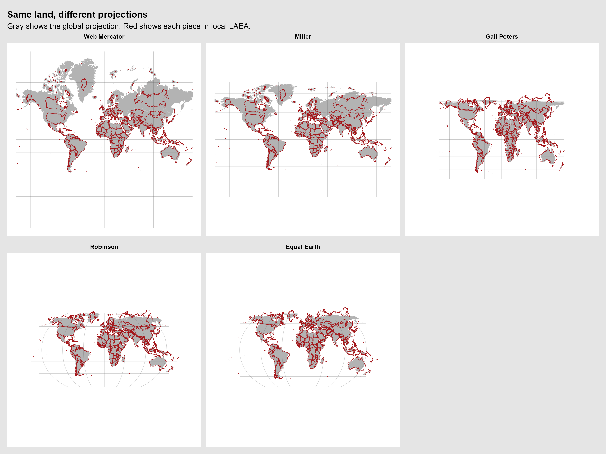
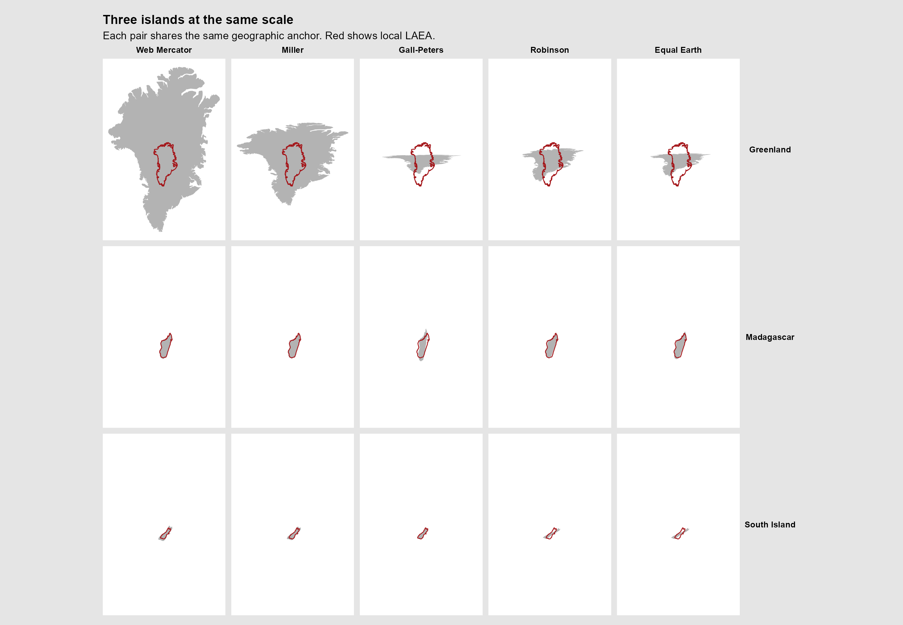

# Local equal-area silhouettes

Compare land shapes in Web Mercator, Miller, Gall-Peters, Robinson and Equal
Earth. The gray land shows each global projection. The red outlines show the
same polygons in local Lambert azimuthal equal-area (LAEA) projections.

The maps build on the Tissot draft in `_Rmd/never-trust-a-map.Rmd` and adapt
[Michael Sumner's LAEA experiment](https://gist.github.com/mdsumner/045b19365f605492baed2fe85b15afd5).

## Run

From the repository root:

```sh
Rscript _experiments/local-laea/local-laea.R
```

R dependencies are **sf**, **giscoR** and **ggplot2**. The first run may need
network access to download the country boundaries.

## Data and rendering

The script uses Eurostat/GISCO country boundaries at 1:10 million, excludes
Antarctica and clips all maps at 85° north and south. It splits the land into
polygons and uses the same longitude–latitude centroid to anchor each piece
across projections.
Red outlines are drawn for pieces larger than 500 km² in Equal Earth.
Miller uses the same sphere radius as Web Mercator. Gall-Peters uses WGS84
and standard parallels at 45° north and south.

Each red outline is projected once in its own LAEA centered on its anchor. In
each world map, it is translated to the corresponding projected anchor. The
island panels move each anchor to the origin and use the same scale in meters
throughout.

## Outputs

Files are saved beside the script.

- `world.png` shows five world maps at a common scale, with the three
  cylindrical projections on the top row.
- `islands.png` compares Greenland, Madagascar and New Zealand's South Island
  at a common scale.




