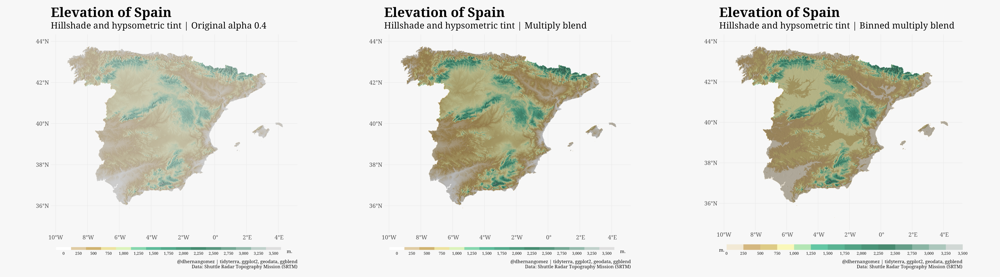

# Spain: hillshade and elevation blending

Compare a transparent elevation overlay with a multiply blend of elevation
colors and a calculated hillshade. This experiment uses SRTM elevation for
Spain and the `spain` hypsometric palette.

The transparency version places elevation at 40% opacity over an opaque
hillshade. The multiply version uses opaque elevation colors and a hillshade
at 85% opacity. A third version uses binned elevation colors with a stepped
legend.

## Run

From the repository root:

```sh
Rscript _experiments/spain-blend/spain-blend.R
```

R dependencies: **terra**, **tidyterra**, **ggplot2**, **geodata**, **scales**,
**ggblend**,
**ragg** and **magick**. **systemfonts** is also used when the optional Noto
Serif
font files are available.

## Data and rendering

`geodata::elevation_30s()` downloads elevation to `~/R/mapslib/misc`. The first
run requires network access; subsequent runs can reuse the cached data. Edit
`data_dir` in the script to use another location.

Negative elevations are clamped to zero. `terra::terrain()` calculates slope
and aspect, and `terra::shade()` uses a light altitude of 30 degrees and an
azimuth of 270 degrees. Elevation and hillshade share the same raster grid.

The full hypsometric ramp is fitted to the local elevation range.
`ggplot_build()` resolves the elevation and grayscale colors before the layers
are passed to **ggblend**. `maxcell = Inf` keeps the color vectors matched to
the
raster cells. An elevation layer underneath the opaque blended layers trains
the scale and generates the legend.

If `~/R/googlefonts` contains the four `NotoSerif-*.ttf` files for regular,
bold, italic and bold italic, the script registers them. Otherwise it uses the
system serif font. Rendering uses **ragg**, which supports compositing groups.

## Outputs

Files are saved beside the script:

- `spain-alpha.png`: elevation at 40% opacity.
- `spain-multiply.png`: multiply blend with hillshade at 85% opacity.
- `spain-binned.png`: multiply blend with binned elevation colors.
- `spain-comparison.png`: the variants side by side.
- `session-info.txt`: the R environment used for rendering.

Individual maps are 12 × 10 inches at 240 dpi. Each map is resized
to a width of 1,400 pixels before the comparison image is assembled.



Based on the [Romania hillshade post](https://dieghernan.github.io/202210_tidyterra-hillshade/)
and [Barney Harris's blending article](https://barney.fly.dev/2026/01/27/ggplot2-blending-adventure/).
