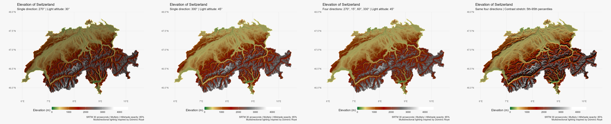

# Switzerland: multidirectional RGB hillshade

Compare four hillshade variants using the same Swiss SRTM elevation grid:

- The existing experiments' baseline: altitude 30° and azimuth 270°.
- A single light: altitude 45° and azimuth 300°.
- Four lights: altitude 45° and azimuths 270°, 15°, 60° and 330°.
- The same four lights with a percentile-based contrast stretch.

The single-light and four-light setups follow Dominic Royé's
[Hillshade effects](https://dominicroye.github.io/blog/hillshade-effect/).
This adaptation averages the four normalized hillshades instead of summing
them, keeping the result within 0–255. The fourth variant stretches that same
average using the method from the [first hillshade post](https://dieghernan.github.io/202210_tidyterra-hillshade/).
It maps the 5th and 95th percentiles to 0 and 255 and clips values outside
that range. The last two panels use identical lighting, so their difference
shows the effect of the stretch.

Each hillshade is displayed as one band repeated across the RGB channels with
`geom_spatraster_rgb()`. Elevation supplies the only `fill` scale and its
legend. **ggblend** multiplies the layers with hillshade opacity of 85%.
All maps use the `dem_poster` palette, identical elevation limits and no raster
interpolation. No **ggnewscale** or external GDAL executable is required.

## Run

From the repository root:

```sh
Rscript _experiments/switzerland-multidirectional/switzerland-multidirectional.R
```

R dependencies: **terra**, **tidyterra**, **ggplot2**, **geodata**, **scales**,
**ggblend**, **ragg** and **magick**.

The script reuses the Swiss elevation cache in `~/R/mapslib/misc`. The first
run requires network access. Slope and aspect are calculated once at the
source resolution, without reprojection, as in the Swiss GDAL experiment.

## Outputs

- `switzerland-baseline.png`: the existing lighting setup rendered as RGB.
- `switzerland-single.png`: Royé's single-direction lighting setup.
- `switzerland-multi.png`: the average of four directional hillshades.
- `switzerland-multi_stretched.png`: the four-direction average with stretched contrast.
- `switzerland-comparison.png`: all four maps side by side.
- `validation.txt`: numerical, grid and thematic scale checks.
- `session-info.txt`: the R environment used for rendering.

Individual maps are 8 × 6.5 inches at 180 dpi.


