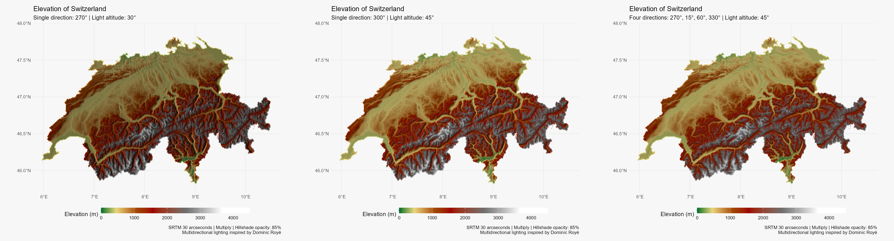

# Switzerland: multidirectional RGB hillshade

Compare three lighting setups using the same Swiss SRTM elevation grid:

- The existing experiments' baseline: altitude 30° and azimuth 270°.
- A single light: altitude 45° and azimuth 300°.
- Four lights: altitude 45° and azimuths 270°, 15°, 60° and 330°.

The latter two setups follow Dominic Royé's
[Hillshade effects](https://dominicroye.github.io/blog/hillshade-effect/).
This adaptation averages the four normalized hillshades instead of summing
them, keeping the result within 0–255. All three maps use this fixed RGB range
without separate contrast stretching. The comparison therefore includes both
the lighting pattern and its resulting brightness.

Each hillshade is displayed as one band repeated across the RGB channels with
`geom_spatraster_rgb()`. Elevation supplies the only `fill` scale and its
legend. **ggblend** multiplies the layers with hillshade opacity of 85%.
All maps use the `dem_poster` palette, identical elevation limits and no raster
interpolation. No **ggnewscale** or external GDAL executable is required.

## Run

From the repository root:

```sh
Rscript _experiments/switzerland-multidirectional/switzerland-multidirectional.R
```

R dependencies: **terra**, **tidyterra**, **ggplot2**, **geodata**, **scales**,
**ggblend**, **ragg** and **magick**.

The script reuses the Swiss elevation cache in `~/R/mapslib/misc`. The first
run requires network access. Slope and aspect are calculated once at the
source resolution, without reprojection, as in the Swiss GDAL experiment.

## Outputs

- `switzerland-baseline.png`: the existing lighting setup rendered as RGB.
- `switzerland-single.png`: Royé's single-direction lighting setup.
- `switzerland-multi.png`: the average of four directional hillshades.
- `switzerland-comparison.png`: all three maps side by side.
- `validation.txt`: numerical, grid and thematic scale checks.
- `session-info.txt`: the R environment used for rendering.

Individual maps are 8 × 6.5 inches at 180 dpi.


