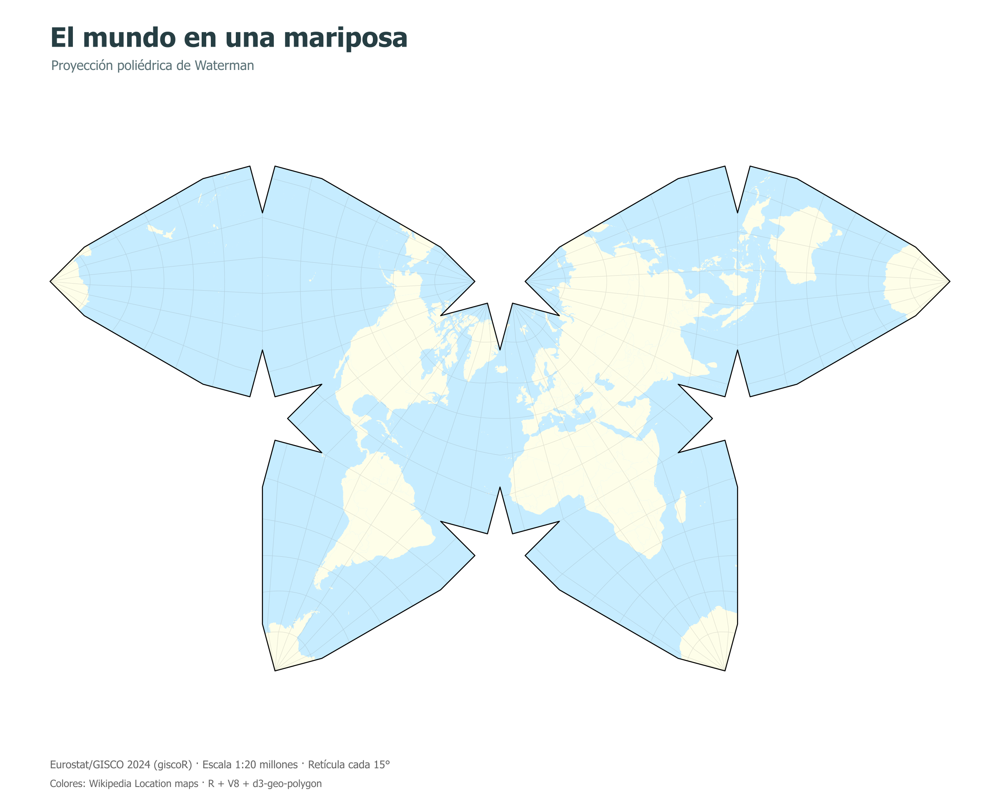

# Waterman world map

Render a world map using D3's polyhedral Waterman projection from R. The script
creates the SVG in a V8 JavaScript session and rasterizes it to PNG.

## Run

From the repository root:

```sh
Rscript _experiments/waterman/waterman.R
```

R dependencies: **sf**, **giscoR**, **V8**, **magick** and **rsvg**. JavaScript
runs inside
**V8**; a separate Node.js installation is not required.

## Data and projection

Country boundaries come from Eurostat/GISCO through **giscoR**, using the 2024
release at 1:20 million resolution. The script downloads these specific versions
of the JavaScript
libraries from jsDelivr and caches them in the local `vendor` directory:

- D3 7.9.0.
- d3-geo-projection 4.0.0.
- d3-geo-polygon 2.0.1.

The first run requires network access for the libraries and boundary data.
Missing cached library files are downloaded on subsequent runs.

The projection uses `geoPolyhedralWaterman()` with `rotate([20, 0])`. Polygon
rings are reversed to match D3's spherical winding convention. The projection
clips countries and a 15-degree graticule at the unfolded face edges.

Land and water colors follow the Wikipedia location-map conventions. Titles
and captions are in Spanish and use a system sans-serif font.

## Outputs

Files are saved beside the script:

- `waterman.svg`: a 1,600 × 1,300 vector map.
- `waterman.png`: a rasterized map at 2,400 pixels wide.
- `vendor/`: the cached JavaScript libraries.


