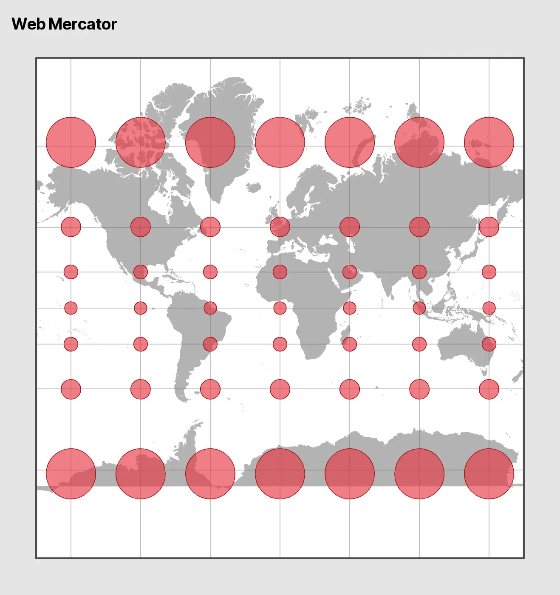
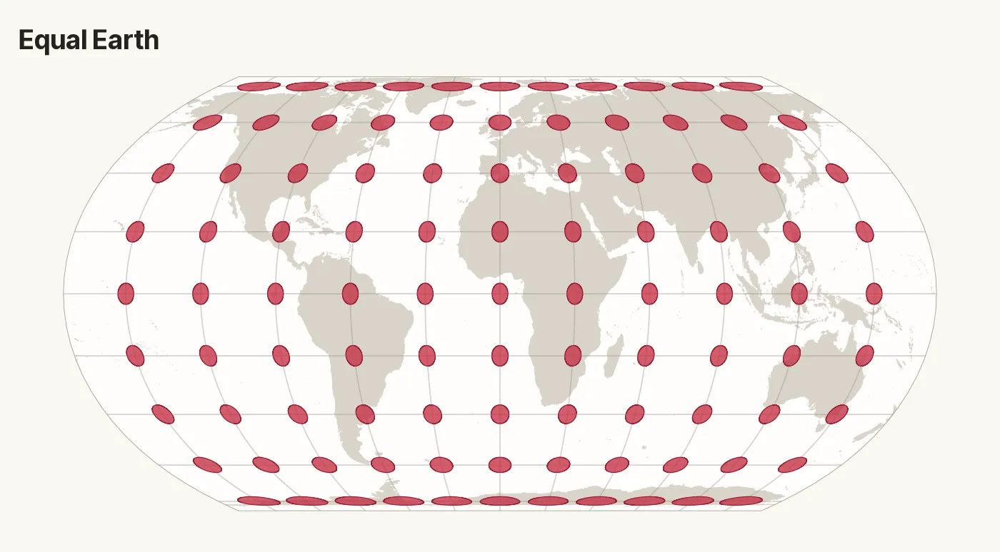
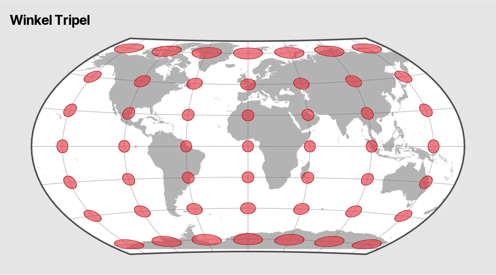
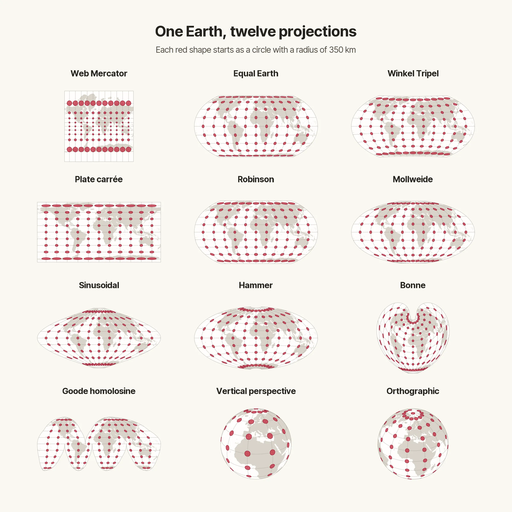
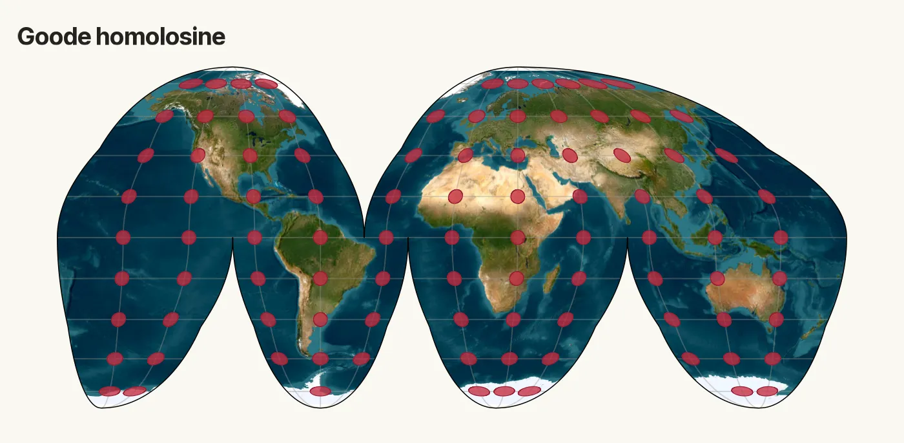

<!-- TODO: Add the r_bloggers tag when this post is published. -->


All maps lie. Some lie more than others, and some are deliberately designed to
mislead us. Mark Monmonier wrote a whole book about it. [*How to Lie with
Maps*](https://press.uchicago.edu/ucp/books/book/chicago/H/bo27400568.html)

Take election maps. [Land doesn't vote. People
do.](https://storymaps.arcgis.com/stories/0e636a652d44484b9457f953994b212b) Yet
a vast, sparsely populated region can dominate a map, while a densely populated
city barely gets noticed. [See the same election mapped several
ways](https://www.esri.com/about/newsroom/arcwatch/explore-a-map-of-election-results)

Change the color scale or the class breaks on a choropleth and the same data can
tell a very different story. [See what changing the class breaks
does](https://www.esri.com/about/newsroom/arcuser/better-breaks-define-your-maps-purpose).
For a worked example with municipal income data from Spain, see [Cómo (no)
mentir con la
visualización](https://cdr-book.github.io/datos-espaciales.html#no-mentir) (in
Spanish).

But even the most honest maps lie.

The Earth is (approximately) spherical, and there’s no way to represent its
curved surface on a flat map without distorting something. A projection can
preserve some properties, such as area or local angles, at the expense of
others.

Fortunately, we have a lie detector.

## Meet Tissot’s indicatrices

Imagine covering the globe with identical small circles. When you flatten the
Earth, those circles can change size, shape or both. The area of each resulting
ellipse shows how much the projection enlarges or shrinks the area at that
location. Its shape reveals whether the projection stretches more in one
direction than another.

### A quick technical note

I'll make the maps in **R**. There are two approaches worth knowing about.

- **tissot** uses PROJ to calculate local distortion factors at each point.
  Those factors describe what happens to infinitesimally small circles and can
  be used to draw the ellipses.
- `geom_tissot()` from **crstools** projects geographic buffers of a fixed
  radius. That gives us a visual approximation we can add as a **ggplot2**
  layer.

I tried both approaches on all twelve projections. After accounting for the
local scale in each direction, the maps looked much the same. I'll use
`geom_tissot()` below to keep the **ggplot2** code short. **tissot** comes in
handy when we want to report or compare the distortion factors themselves.

Let's put some maps to the test.

## Same circles, different maps

We start with the same grid for all twelve projections. That's 99 points in nine
rows and eleven columns, with a circle of 350 km radius at each point. The red
shapes show what happens to those circles when we change the projection.


## Three ways to handle distortion

Each approach makes a different trade-off.

- **Conformal.** These projections preserve local angles and shapes, so tiny
  circles stay round even when their size changes. Mercator is useful for
  navigation because a constant compass bearing follows a straight line.
- **Equal-area.** These projections keep areas in proportion, even when shapes
  stretch. Equal Earth works well for thematic world maps, where readers may
  want to compare how much land different regions or categories cover.
- **Compromise.** These projections balance different kinds of distortion. Both
  area and shape can change. Robinson and Winkel Tripel are useful for
  general-purpose world maps and atlases, where the overall view matters.

Dominic Royé discusses these trade-offs in more depth in his [practical guide to
map projections](https://dominicroye.github.io/blog/map-projections/).

## Web Mercator

If the circles are still circles, where's the lie?



Web Mercator comes close to the classic **conformal** pattern. Compare the
middle row with the rows above and below. The circles stay roughly round, but
they grow much larger toward high latitudes. That's how Greenland ends up
looking so big.

## Equal Earth

Equal Earth is an **equal-area** projection. What happens to the circles when we
preserve area?



The shapes give the game away. The circles flatten toward the top and bottom,
but their areas stay roughly the same.

## Winkel Tripel

Winkel Tripel is a **compromise** projection. What happens when we let both
shape and area change?



Follow the second row from the top, east across Russia, and watch the ellipses
stretch and tilt. Then compare them with the equatorial row to see how their
areas change as well.

## Twelve ways to flatten the world

Pick a red circle near Greenland and follow it from map to map. The last two
views share a center over North Africa. The vertical perspective shows less of
the globe because its viewpoint is only 10,000 km above the surface. Both views
include a bonus circle at the North Pole.

Each map is scaled independently to fit its panel. Compare circle sizes 
**within** each map. You can compare shapes across panels. 
{: .alert .alert-info .p-3 .mx-2 .mb-3}



The outlines can fool you, too. Compare the two rectangles in the first column.
In Web Mercator, the circles stay roughly round and grow toward the poles. In
Gall–Peters, their areas stay roughly constant within the panel. They stretch
vertically near the equator and flatten at high latitudes.

On the second row, compare Robinson with the apple-shaped Van der Grinten IV.
Look toward the outer meridians at high latitudes to see where Van der Grinten
IV distorts area the most.

The third row puts Mollweide and Sinusoidal next to Goode homolosine, which uses
Sinusoidal near the equator and Mollweide at higher latitudes.

Here's one way to group the twelve projections in the poster.

- **Conformal pattern.** Web Mercator.
- **Equal-area.** Equal Earth, Gall–Peters, Mollweide, Sinusoidal, Bonne and
  Goode homolosine.
- **Compromise.** Winkel Tripel and Robinson.
- **Globular.** Van der Grinten IV.
- **Perspective views.** Vertical perspective and Orthographic.

So which map should you trust? It depends on what you're asking it to show.
Choose an equal-area map to compare areas, a conformal one when local angles
matter or a compromise for an overall view. The question is whether the lie
helps you see what you're looking for.

<iframe
  class="d-block w-100 border-0 rounded my-3"
  title="Little Lies by Fleetwood Mac on Spotify"
  src="https://open.spotify.com/embed/track/08o75xMKmGrKny6GsXrNJW?theme=0"
  height="152"
  loading="lazy"
  allow="autoplay; clipboard-write; encrypted-media; fullscreen; picture-in-picture"
  allowfullscreen>
</iframe>

## How we drew it

For more projection examples with **sf** and **ggplot2**, see Nabil-Fareed
Alikhan's [*Variations on map projections in
R*](https://happykhan.com/posts/map-projections-in-r).

<details class="my-4" markdown="1">

<summary>Show the R code</summary>

In **R**, we get country boundaries from **giscoR**, build the grid with **sf**
and draw the maps with **ggplot2** and **crstools**. The setup also loads Inter
Tight for the map titles. `draw_map()` handles Goode's cuts and the horizons of
the two perspective views. It also accepts an optional raster basemap through
`tile`, which it reprojects and clips to the map outline. For Van der Grinten
IV, the function builds the same geographic buffers with **sf** and projects
them directly because PROJ only provides the forward transform.


``` r
map_family <- "inter-tight"
sysfonts::font_add_google("Inter Tight", family = map_family)
showtext::showtext_opts(dpi = knitr::opts_chunk$get("dpi"))
showtext::showtext_auto()
library(crstools)
library(ggplot2)
library(sf)

meridians <- seq(-150, 150, 30)
parallels <- seq(-75, 75, length.out = 9)
earth_radius <- 6371007.181
buffer_km <- 350
light_palette <- list(
  background = "#FAF8F2",
  ocean = "#FFFEFC",
  land = "#D9D4CA",
  graticule = "#99948B",
  outline = "#A6A097",
  circle = "#C52E43",
  circle_outline = "#982035",
  text = "#252320",
  muted_text = "#504A43"
)

dark_palette <- list(
  background = "#535c64",
  ocean = "#2c353c",
  land = "#0e0e0e",
  graticule = "#82909B",
  outline = "grey50",
  circle = "#F15B66",
  circle_outline = "#F78A92",
  text = "#F3F5F7"
)
perspective_height <- 10000000
view_center <- "+lat_0=30 +lon_0=10"

projections <- c(
  "Gall-Peters" = "+proj=cea +lat_ts=45 +R=6371007.181",
  "Web Mercator" = "EPSG:3857",
  "Robinson" = "+proj=robin",
  "Van der Grinten IV" = "+proj=vandg4 +R=6371007.181",
  "Winkel Tripel" = "+proj=wintri",
  "Mollweide" = "ESRI:54009",
  "Sinusoidal" = "ESRI:54008",
  "Equal Earth" = "+proj=eqearth +datum=WGS84",
  "Goode homolosine" = "+proj=igh +R=6371007.181",
  "Bonne" = "ESRI:54024",
  "Vertical perspective" = sprintf(
    "+proj=nsper %s +R=%.3f +h=%.0f", view_center, earth_radius, perspective_height
  ),
  "Orthographic" = sprintf("+proj=ortho %s +R=%.3f", view_center, earth_radius)
)

frame <- st_linestring(rbind(
  c(-175, 85),
  c(175, 85),
  c(175, -85),
  c(-175, -85),
  c(-175, 85)
)) |>
  st_segmentize(5) |>
  st_cast("POLYGON") |>
  st_sfc(crs = 4326)

world <- giscoR::gisco_get_countries(epsg = 4326, resolution = 3)
graticule <- st_graticule(frame, lon = meridians, lat = parallels)

goode_lat <- c(90:-90, rep(c(-90:0, 0:-90), 3), -90:90, 90:0, 0:90, 90)
goode_lon <- c(
  rep(180, 181),
  rep(c(80.01, 79.99, -19.99, -20.01, -99.99, -100.01), each = 91),
  rep(-180, 181),
  rep(c(-40.01, -39.99), each = 91),
  180
)
goode_frame <- st_sfc(st_polygon(list(cbind(goode_lon, goode_lat))), crs = 4326)

goode_lobes <- rbind(
  c(-180, -40, 0, 90),
  c(-40, 180, 0, 90),
  c(-180, -100, -90, 0),
  c(-100, -20, -90, 0),
  c(-20, 80, -90, 0),
  c(80, 180, -90, 0)
)

goode_lines <- lapply(seq_len(nrow(goode_lobes)), function(index) {
  bounds <- goode_lobes[index, ]
  longitude <- seq(bounds[1] + 0.01, bounds[2] - 0.01, length.out = 361)
  latitude <- seq(bounds[3] + 0.01, bounds[4] - 0.01, length.out = 181)
  lng <- meridians[meridians > bounds[1] & meridians < bounds[2]]
  lat <- parallels[parallels > bounds[3] & parallels < bounds[4]]
  c(
    lapply(lng, function(x) st_linestring(cbind(x, latitude))),
    lapply(lat, function(y) st_linestring(cbind(longitude, y)))
  )
})
goode_grid <- st_sfc(
  c(
    list(st_linestring(cbind(seq(-179.99, 179.99, length.out = 721), 0))),
    do.call(c, goode_lines)
  ),
  crs = 4326
)
```


``` r
indicatrices <- function(lng, lat, palette) {
  geom_tissot(
    data = world,
    radius = units::as_units(buffer_km, "km"),
    fill = palette$circle,
    color = palette$circle_outline,
    alpha = 0.78,
    centres = list(lng = lng, lat = lat)
  )
}

draw_map <- function(title, palette = light_palette, tile = NULL) {
  projection <- projections[[title]]
  grid <- graticule
  if (title == "Van der Grinten IV") {
    # PROJ provides only a forward transform for this projection.
    buffers <- expand.grid(lng = meridians, lat = parallels) |>
      st_as_sf(coords = c("lng", "lat"), crs = 4326) |>
      st_buffer(units::as_units(buffer_km, "km")) |>
      st_transform(projection)
    circles <- geom_sf(
      data = buffers, fill = palette$circle, color = palette$circle_outline,
      alpha = 0.78
    )
  } else {
    circles <- indicatrices(meridians, parallels, palette)
  }
  if (is.null(tile)) {
    land <- st_geometry(world)
  }
  radians <- pi / 180
  buffer_limit <- sin(buffer_km * 1000 / earth_radius)

  if (title == "Goode homolosine") {
    outline <- st_transform(goode_frame, projection)
    grid <- st_transform(goode_grid, projection)
    circles <- lapply(parallels, function(lat) {
      cuts <- if (lat > 0) -40 else c(-100, -20, 80)
      longitude_gap <- abs((outer(meridians, cuts, "-") + 180) %% 360 - 180)
      distance <- sin(pmin(longitude_gap, 90) * radians) * cos(lat * radians)
      visible <- meridians[apply(distance, 1, min) > buffer_limit]
      indicatrices(visible, lat, palette)
    })
  } else if (title %in% c("Vertical perspective", "Orthographic")) {
    height <- if (title == "Vertical perspective") perspective_height else Inf
    horizon <- acos(earth_radius / (earth_radius + height))
    disk_radius <- earth_radius / sqrt(1 + 2 * earth_radius / height)
    outline <- st_sfc(st_point(c(0, 0)), crs = projection) |>
      st_buffer(disk_radius, nQuadSegs = 180)

    # Clip land just inside the horizon in a distance-preserving projection.
    distance_crs <- sprintf("+proj=aeqd %s +R=%.3f", view_center, earth_radius)
    visible_cap <- st_sfc(st_point(c(0, 0)), crs = distance_crs) |>
      st_buffer(horizon * earth_radius - 1, nQuadSegs = 180)
    if (is.null(tile)) {
      land <- st_transform(land, distance_crs, partial = TRUE) |>
        st_make_valid() |>
        st_intersection(visible_cap)
    }

    if (title == "Vertical perspective") {
      grid <- st_geometry(grid) |>
        st_transform(distance_crs) |>
        st_intersection(visible_cap) |>
        st_transform(projection, partial = FALSE)
    }

    # Keep circles whose entire buffer fits inside the horizon.
    buffer_cutoff <- cos(horizon - buffer_km * 1000 / earth_radius)
    circles <- lapply(parallels, function(lat) {
      cosine <- sin(lat * radians) * sin(30 * radians) +
        cos(lat * radians) * cos(30 * radians) *
          cos((meridians - 10) * radians)
      visible <- meridians[cosine > buffer_cutoff]
      if (length(visible)) indicatrices(visible, lat, palette)
    })
    # All meridians meet at the pole, so draw one circle there.
    circles <- c(circles, list(indicatrices(10, 90, palette)))
  } else {
    outline <- st_transform(frame, projection, partial = TRUE)
  }

  limits <- st_bbox(outline)

  lwd_outline <- 0.15

  if (is.null(tile)) {
    land <- st_transform(land, projection, partial = TRUE)
    if (st_is_longlat(land)) {
      # Clip the longitude-latitude panel in its display coordinates.
      land <- st_set_crs(land, NA) |>
        st_make_valid() |>
        st_intersection(st_set_crs(outline, NA)) |>
        st_set_crs(projection)
    } else {
      land <- st_intersection(st_make_valid(land), st_make_valid(outline))
    }
    basemap <- geom_sf(
      data = land, fill = palette$land, color = palette$land, linewidth = 0.15
    )
  } else {
    mask <- terra::vect(outline)
    imagery <- terra::project(tile, projection, method = "bilinear") |>
      terra::crop(mask, mask = TRUE)
    basemap <- tidyterra::geom_spatraster_rgb(data = imagery, maxcell = Inf)
    palette$outline <- "black"
    lwd_outline <- 0.25
  }

  ggplot() +
    geom_sf(data = outline, fill = palette$ocean, color = NA) +
    basemap +
    geom_sf(
      data = grid,
      color = palette$graticule,
      alpha = 0.4,
      linewidth = 0.3
    ) +
    geom_sf(
      data = outline, fill = NA, color = palette$outline,
      linewidth = lwd_outline
    ) +
    circles +
    coord_sf(
      crs = projection,
      xlim = limits[c("xmin", "xmax")],
      ylim = limits[c("ymin", "ymax")],
      datum = NA
    ) +
    labs(title = title) +
    theme_void(base_family = map_family) +
    theme(
      text = element_text(colour = palette$text),
      plot.title = element_text(face = "bold"),
      plot.margin = margin(10, 10, 10, 10),
      plot.background = element_rect(fill = palette$background, color = NA),
      panel.background = element_rect(fill = palette$background, color = NA)
    )
}
```


``` r
draw_map("Web Mercator")
draw_map("Equal Earth")
draw_map("Winkel Tripel")
```

Here's the Goode homolosine projection with Esri World Imagery. The tile
replaces the vector land layer. The graticule and red indicatrices are drawn
over it.


``` r
world_tile <- maptiles::get_tiles(
  st_transform(world, 3857),
  provider = "Esri.WorldImagery",
  zoom = 2,
  crop = FALSE,
  cachedir = tools::R_user_dir("maptiles", "cache")
)
draw_map("Goode homolosine", tile = world_tile)
```



*Imagery from Esri World Imagery. Source: Esri, Vantor, Earthstar Geographics
and the GIS User Community.*

</details>

<details class="my-4" markdown="1">

<summary>Show the gallery code</summary>


``` r
featured <- c("Web Mercator", "Equal Earth", "Winkel Tripel")
gallery_order <- c(featured, setdiff(names(projections), featured))

grid::grid.newpage()
grid::grid.rect(gp = grid::gpar(fill = light_palette$background, col = NA))
grid::pushViewport(grid::viewport(
  width = 0.92,
  height = 0.92,
  layout = grid::grid.layout(
    7, 3,
    heights = grid::unit(c(2, 1.5, 1, 10, 10, 10, 10), "null")
  )
))
grid::grid.text(
  "One Earth, twelve projections",
  gp = grid::gpar(
    fontfamily = map_family, fontsize = 25, fontface = "bold", col = light_palette$text
  ),
  vp = grid::viewport(layout.pos.row = 1, layout.pos.col = 1:3)
)
grid::grid.text(
  "Each red shape starts as a circle with a radius of 350 km",
  gp = grid::gpar(fontfamily = map_family, fontsize = 14, col = light_palette$muted_text),
  vp = grid::viewport(layout.pos.row = 2, layout.pos.col = 1:3)
)

for (index in seq_along(gallery_order)) {
  title <- gallery_order[[index]]
  grid::pushViewport(grid::viewport(
    layout.pos.row = (index - 1) %/% 3 + 4,
    layout.pos.col = (index - 1) %% 3 + 1,
    layout = grid::grid.layout(2, 1, heights = grid::unit(c(1, 9), "null"))
  ))
  grid::grid.text(
    title,
    gp = grid::gpar(
      fontfamily = map_family, fontsize = 14, fontface = "bold", col = light_palette$text
    ),
    vp = grid::viewport(layout.pos.row = 1)
  )
  grid::pushViewport(grid::viewport(layout.pos.row = 2))
  map <- draw_map(title) + theme(plot.title = element_blank())
  print(map, vp = grid::viewport(width = 0.94, height = 0.94))
  grid::popViewport(2)
}
grid::popViewport()
```

</details>


## References

- Alikhan, N.-F. (2022, May 20). Variations on map projections in R.
  *Happykhan*. <https://happykhan.com/posts/map-projections-in-r>.
- Fernández-Avilés, G. (2024). Trabajando con datos espaciales. In G.
  Fernández-Avilés & J.-M. Montero (Eds.), *Fundamentos de ciencia de datos con
  R* (Chapter 40). McGraw Hill.
  <https://cdr-book.github.io/datos-espaciales.html>.
- Manica A, Pozzi A, Padilla-Iglesias C, Carter E, Leonardi M, Fatima A, Pelanek
  O, Stephenson N, Colucci M, Jud D, Gunasekaram C (2026). *crstools: Tools to
  Work with Projections*. <https://doi.org/10.32614/CRAN.package.crstools>. R
  package version 1.0.0, <https://CRAN.R-project.org/package=crstools>.
- Monmonier, M. (2018). *How to lie with maps* (3rd ed.). University of Chicago
  Press.
- Royé, Dominic. 2026. “Map Projections: A Practical Guide to Common Mistakes
  and How to Fix Them.” May 3.
  <https://dominicroye.github.io/blog/map-projections/>.
- Snyder, J. P. (1987). *Map projections--A working manual*. U.S. Geological
  Survey. <https://doi.org/10.3133/pp1395>
- Sumner M, Huber B (2026). *tissot: Tissot Indicatrix for Map Projection
  Distortion*. <https://doi.org/10.32614/CRAN.package.tissot>. R package version
  0.3.0, <https://CRAN.R-project.org/package=tissot>.
- Tissot, N. A. (1881). *Mémoire sur la représentation des surfaces et les
  projections des cartes géographiques*. Gauthier-Villars.
