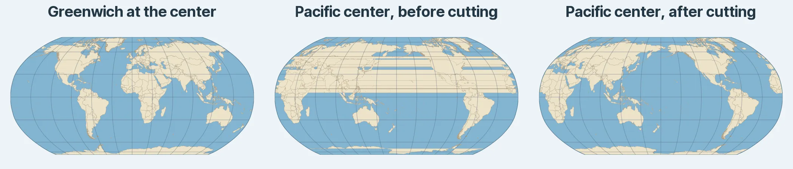
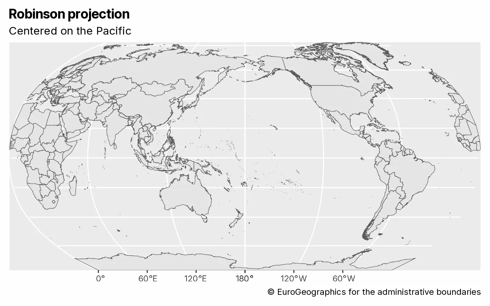
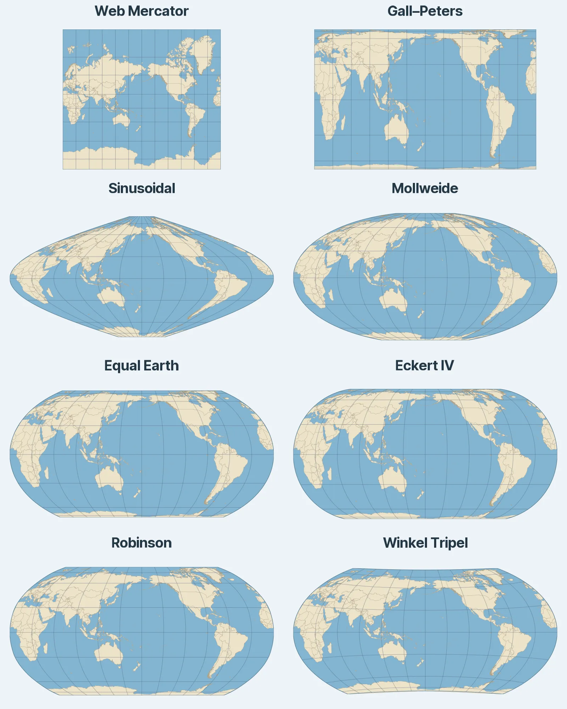

---
series:
  - id: quick-r
    order: 4
title: "How to center a world map on the Pacific"
subtitle: "One ocean, eight projections"
excerpt: >-
  Move the cut to Greenwich, put the Pacific in the middle, and draw
  the same world in eight different projections with sf and ggplot2.
description: >-
  Use sf, giscoR and ggplot2 to cut world polygons at a new meridian and
  draw eight Pacific-centered map projections.
header_img: "https://dieghernan.github.io/assets/img/drafts/pacific-centered-world-maps-cover-1.webp"
og_image: "https://dieghernan.github.io/assets/img/drafts/pacific-centered-world-maps-cover-1.webp"
og_image_width: 1200
og_image_height: 630
og_image_type: image/webp
og_image_alt: >-
  An Equal Earth map with the blue Pacific in the middle, ivory land on
  either side, Asia and Oceania on the left and the Americas on the right.
tags:
  - maps
  - sf
  - giscoR
  - ggplot2
  - rspatial
  - rstats
output:
  md_document:
    variant: gfm
    preserve_yaml: true
---

<!-- TODO: Add the r_bloggers tag when this post is published. -->


On a world map centered on Greenwich, Japan and California sit near opposite
edges. Shift the center to the Pacific and the two coasts face each other across
one continuous ocean. That view is useful for maps of the Pacific Rim, trade
routes, marine biodiversity or simply a less Europe-centric world.

I tried this with Robinson in **R**. The middle map shows what happens when you
change the center and leave the polygons as they are.



## Cut first, project second

With the Pacific at 180°, Greenwich becomes the edge of the map. If a country
polygon crosses Greenwich, its vertices can end up on opposite edges and still
be joined by a line. That's where the stripes come from. I pass the same `lon_0`
to
[`st_break_antimeridian()`](https://r-spatial.github.io/sf/reference/st_break_antimeridian.html)
and to the projection so the polygons are split at the new edge before **PROJ**
transforms them.

I'm using the 2024 country boundaries from **giscoR**. I convert them from Web
Mercator to longitude and latitude, then crop the map from 80° S to 85° N. That
keeps all of Greenland in view and trims Antarctica in Web Mercator. For that
crop, I temporarily remove the CRS so the bounds are treated as a rectangle in
degrees.


``` r
library(giscoR)
library(sf)
library(ggplot2)

countries <- gisco_get_countries(year = 2024, resolution = "03", epsg = 3857)
south_limit <- -80
north_limit <- 85

world <- countries |>
  st_transform(4326) |>
  st_set_crs(NA) |>
  st_make_valid() |>
  st_crop(c(xmin = -180, ymin = south_limit, xmax = 180, ymax = north_limit)) |>
  st_set_crs(st_crs(4326))
```

Once `world` is ready, `project_world()` cuts the polygons opposite `lon_0` and
projects them. When `lon_0` is 0°, the 180° meridian is at the map's edge. For
other centers, it falls inside the map, where the original split in the
**giscoR** boundaries can leave gaps in Antarctica, Fiji and eastern Russia.
I regroup the pieces by country and use small buffers to close gaps along that
interior seam in geographic coordinates, while it is still a straight line.

<div class="callout-important" role="note" aria-label="Important" markdown="1">
Pass `projection` as a [PROJ
string](https://proj.org/en/stable/usage/quickstart.html) such as
`"+proj=robin"`. `project_world()` appends `+lon_0` to that string. An Esri CRS
code such as `"ESRI:54030"` (World Robinson) won't work in its place.
</div>


``` r
project_world <- function(world, projection, lon_0 = 180) {
  crs <- paste0(projection, " +lon_0=", lon_0)
  parts <- st_sf(source_row = seq_len(nrow(world)), geometry = st_geometry(world)) |>
    st_break_antimeridian(lon_0 = lon_0)

  projected <- parts |>
    st_transform(crs) |>
    st_make_valid()

  # Reassemble the pieces and restore each country's original attributes.
  grouped <- aggregate(projected, list(row = projected$source_row), FUN = min)
  geometry <- st_geometry(grouped)

  if (lon_0 != 0) {
    # Put the map cut at ±180° in a temporary geographic CRS.
    rotated_crs <- paste0("+proj=longlat +datum=WGS84 +pm=", lon_0)
    seam_lon <- (360 - lon_0) %% 360 - 180
    bounds <- st_bbox(world)
    bounds[c("xmin", "xmax")] <- seam_lon + c(-0.0003, 0.0003)
    seam <- st_as_sfc(bounds) |> st_set_crs(NA)

    repair <- which(world$ISO3_CODE[grouped$row] %in% c("ATA", "FJI", "RUS"))
    for (i in repair) {
      # Repair the original seam while it is still a straight meridian.
      land <- st_geometry(parts)[parts$source_row == grouped$row[i]] |>
        st_transform(rotated_crs) |>
        st_set_crs(NA) |>
        st_make_valid() |>
        st_union()
      closed <- land |>
        st_buffer(0.0001) |>
        st_buffer(-0.0001)
      patch <- st_intersection(closed, seam)
      geometry[i] <- st_union(c(land, patch)) |>
        st_set_crs(rotated_crs) |>
        st_transform(crs) |>
        st_make_valid()
    }
  }

  st_set_geometry(world[grouped$row, ], geometry)
}

pacific <- project_world(world, "+proj=robin")
```

A quick plot in **ggplot2** shows the result.


``` r
map_title <- "inter-tight"
map_regular <- "inter"

sysfonts::font_add_google("Inter Tight", family = map_title)
sysfonts::font_add_google("Inter", family = map_regular)
showtext::showtext_opts(dpi = knitr::opts_chunk$get("dpi"))
showtext::showtext_auto()

ggplot() +
  geom_sf(data = pacific) +
  coord_sf(expand = FALSE) +
  theme(
    text = element_text(family = map_regular),
    plot.title = element_text(family = map_title, face = "bold"),
    plot.background = element_rect(fill = "#FEFDFD"),
    plot.margin = margin(t = 10, b = 10, l = 10, r = 10)
  ) +
  labs(
    title = "Robinson projection",
    subtitle = "Centered on the Pacific",
    caption = giscoR::gisco_attributions()
  )
```



<details class="my-4" markdown="1">

<summary>Show the code for the styled Robinson map</summary>

I drew the frame and graticule in longitude and latitude, then projected both to
the same CRS as the land. Here's the code for the colors, frame and grid.


``` r
map_title <- "inter-tight"
sysfonts::font_add_google("Inter Tight", family = map_title)
showtext::showtext_opts(dpi = knitr::opts_chunk$get("dpi"))
showtext::showtext_auto()

map_palette <- list(
  background = "#EEF3F7",
  ocean = "#83B4D2",
  land = "#EDE2C9",
  borders = "#AC9A7B",
  graticule = "#4F6776",
  outline = "#52778C",
  text = "#243746"
)

map_theme <- theme_void(base_family = map_title) +
  theme(
    plot.margin = margin(8, 10, 8, 10),
    plot.background = element_rect(fill = map_palette$background, color = NA)
  )
```


``` r
frame_path <- function(lon, lat) {
  cbind((lon + 180) %% 360 - 180, lat)
}

draw_map <- function(land, lon_0) {
  crs <- st_crs(land)
  # Keep each side of the frame just inside the cut.
  left <- lon_0 - 179.9999
  right <- lon_0 + 179.9999
  lon <- seq(left, right, length.out = 361)
  lat <- seq(south_limit, north_limit, by = 1)
  ring <- rbind(
    frame_path(lon, south_limit),
    frame_path(right, lat[-1]),
    frame_path(rev(lon)[-1], north_limit),
    frame_path(left, rev(lat)[-1])
  )

  frame <- st_sfc(st_polygon(list(ring)), crs = 4326) |>
    st_transform(crs)

  meridians <- lapply(seq(-150, 150, 30) + lon_0, function(x) {
    st_linestring(frame_path(x, lat))
  })
  parallels <- lapply(c(-75, seq(-60, 60, 30), 75), function(y) {
    st_linestring(frame_path(lon, y))
  })
  grid <- st_sfc(c(meridians, parallels), crs = 4326) |>
    st_transform(crs)

  ggplot() +
    geom_sf(data = frame, fill = map_palette$ocean, color = NA) +
    geom_sf(
      data = land, fill = map_palette$land, color = map_palette$borders,
      linewidth = 0.05
    ) +
    geom_sf(
      data = grid, color = map_palette$graticule, alpha = 0.45,
      linewidth = 0.2
    ) +
    geom_sf(
      data = frame, fill = NA, color = map_palette$outline,
      linewidth = 0.2
    ) +
    coord_sf(crs = crs, datum = NA, expand = FALSE) +
    map_theme
}
```

``` r
draw_map(pacific, lon_0 = 180)
```

</details>

## Same center, eight projections

Let's keep the Pacific in the middle and change the projection. Look at
Greenland in Web Mercator and Equal Earth, or at the outline of the Sinusoidal
map. The center stays put even as the shapes change.


``` r
projections <- c(
  "Web Mercator" = "+proj=webmerc +datum=WGS84",
  "Gall–Peters" = "+proj=cea +lat_ts=45 +R=6371007.181",
  "Sinusoidal" = "+proj=sinu",
  "Mollweide" = "+proj=moll",
  "Equal Earth" = "+proj=eqearth +datum=WGS84",
  "Eckert IV" = "+proj=eck4",
  "Robinson" = "+proj=robin",
  "Winkel Tripel" = "+proj=wintri"
)

maps <- lapply(projections, function(projection) {
  project_world(world, projection, lon_0 = 180)
})
```



© EuroGeographics for the administrative boundaries
{: .caption }

You can move the center again. Try
`project_world(world, "+proj=robin", lon_0 = -90)` to center the map at 90° W
and put the cut at 90° E.

**Cut first, project second**. That’s the whole trick.


<!-- No references needed in this post. -->

<div role="note" aria-label="Note" class="callout-note" markdown="1">
I used AI to draft and revise this post and to help develop parts of the
**R** code.
</div>
